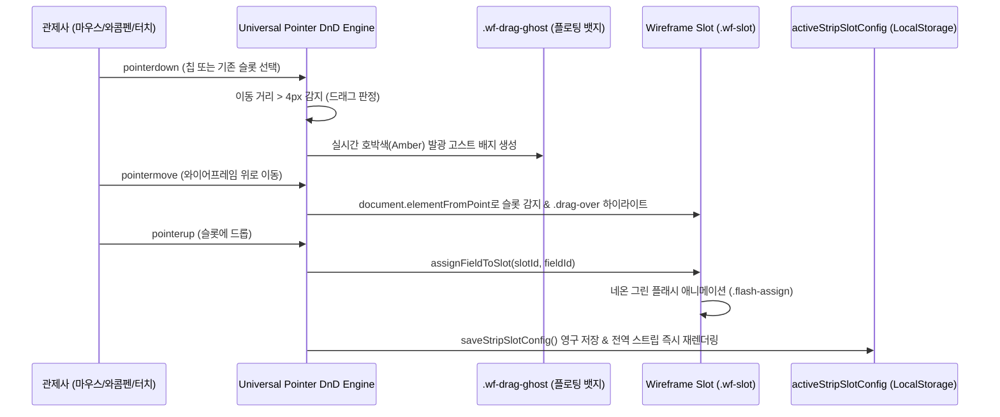

# EFS (Electronic Flight Strip / 전자비행스트립) 기술 문서
**System Technical Specification & Architecture Whitepaper**

*문서 버전: v2.5.0 | 최종 개정일: 2026년 9월 23일 | 분류: 항공교통관제(ATC/ATM) 전자비행스트립 기술 규격서*

---

## 1. 시스템 개요 및 개념 정의 (System Overview & Concept)

### 1.1 시스템 정의 (Definition)
**EFS(Electronic Flight Strip, 전자비행스트립)**는 공항 관제탑(Tower), 지상관제(Ground), 계류장관제(Ramp), 접근관제소(Approach)에서 항공기의 출발, 이동, 이착륙, 통과, 장주 훈련 등 비행 진행 상태를 관리하기 위해 전통적으로 사용되던 종이 비행스트립(Paper Flight Strip)을 **완전 디지털화하고 실시간 항공통신망(AMHS/AFTN), 비행계획서(FPL), 운항스케줄(UBIKAIS), 협력적의사결정(A-CDM)과 연동하여 자동화된 관제 흐름을 제공하는 차세대 웹 기반 전자비행스트립 시스템**입니다.

```
       ┌─────────────────────────────────────────────────────────────┐
       │     대한항공 ACROSS / 항공교통본부(UAO) 표준 관제 콘솔       │
       │              EFS (전자비행스트립 단말 UI)                   │
       └──────────────────────────────▲──────────────────────────────┘
                                      │ Real-time HTTPS / WebSockets / JSON
       ┌──────────────────────────────┴──────────────────────────────┐
       │             EFS API Gateway & Message Processor             │
       │   Node.js / Serverless / AMHS Parser / Supabase PostgREST   │
       └──────▲────────────────▲────────────────▲────────────────▲───┘
              │                │                │                │
  ┌───────────┴────────┐ ┌─────┴──────────┐ ┌───┴─────────────┐ ┌┴─────────────────┐
  │ AMHS/AFTN 항공전문 │ │ UBIKAIS 국토부 │ │ Wacom Stylus    │ │ A-CDM 협력적      │
  │ FPL/CHG/CNL/DEP/ARR│ │ 실시간 운항일정│ │ 디지털 수기 필기│ │ 의사결정 시각동기 │
  └────────────────────┘ └────────────────┘ └─────────────────┘ └───────────────────┘
```

### 1.2 전통 종이 스트립의 한계와 EFS의 혁신
1. **물리적 수작업 및 인지 부하 극복**: 종이 스트립 출력, 거치대(Bay) 수동 이동, 수기 작성의 번거로움을 드래그 앤 드롭 및 자동 상태 전이(State Machine)로 디지털화.
2. **초소형 전술 스트립 카드 규격 (`--strip-card-h: 68px`)**: 제한된 관제 화면 공간 내에 최대 4개 베이(출발/도착/통과/장주)와 수십 편의 항공기를 스크롤 없이 한눈에 조망할 수 있는 컴팩트 5구역 25슬롯 그리드 설계.
3. **와콤(Wacom) 스타일러스 펜 디지털 수기 필기 (Digital Inking)**: 관제사의 오랜 직관적 업무 습관인 '스트립 위 수기 펜 기입(인가 고도 체크, 헤딩 기입, 취소선)'을 브라우저 캔버스 레이어로 100% 보존 (Palm Rejection 지원).
4. **시각적 와이어프레임 커스터마이징 (Visual Wireframe Builder)**: 공항 및 관제 석(Delivery, Ground, Tower)마다 다른 스트립 표기 양식을 관제사가 드래그 앤 드롭으로 직접 재배치할 수 있는 자유도 제공.
5. **대량 운항편 일괄 관리 엑셀 그리드 (Excel Batch Registry)**: 복잡한 폼 입력 없이 엑셀처럼 한눈에 보며 행 단위로 비행편을 일괄 생성·수정.

---

## 2. 기술 스택 (Technology Stack Architecture)

EFS는 항공관제 현장의 무지연성(Zero-Latency), 높은 가독성, 하드웨어 호환성을 위해 최적화된 스택으로 구성되어 있습니다.

| 계층 (Layer) | 분류 | 적용 기술 (Technology) | 세부 스펙 및 역할 |
|:---|:---|:---|:---|
| **Frontend** | **UI Core** | **Vanilla HTML5 & ES2022+** | 프레임워크 오버헤드 없는 즉각적인 DOM 렌더링 및 60fps 인터랙션 유지 |
| | **Styling** | **CSS3 Grid, Flexbox & Custom Properties** | 매트 차콜 다크 테마, 4대 베이 시그니처 색상, CRT 스캔라인 아날로그 효과 |
| | **Typography** | **Pretendard, JetBrains Mono, Space Grotesk** | 관제 호출부호 및 숫자에 최적화된 고시인성 모노스페이스 타이포그래피 |
| | **DnD Engine** | **SortableJS v1.15.2 (Embedded)** | 베이 내 스트립 순서 정렬 및 베이 간 물리적 드래그 이동 (100% 오프라인 지원) |
| | **Pointer DnD**| **Universal Pointer Event Engine** | 와이어프레임 빌더 전용 (마우스, 와콤 펜, 터치스크린 100% 호환 드래그 앤 드롭) |
| | **Inking API** | **HTML5 Dual-Layer Canvas** | 와콤 스타일러스 펜 입력 감지(`pointerType === 'pen'`), 팜 리젝션, 전자 잉크 렌더링 |
| **Backend** | **Runtime** | **Node.js (Serverless Functions)** | Vercel Serverless Architecture, 무중단 오토스케일링 |
| | **Gateway API** | **`/api/efs` (RESTful Endpoint)** | 스트립 CRUD, 베이 시퀀싱, AMHS 전문 수신, 엑셀 배치 일괄 등록 |
| | **AMHS Parser**| **Custom Aeronautical Parser** | ICAO FPL, CHG, CNL, DLA, DEP, ARR, IPN(NDR/DR) XML/SOAP/AFTN 정밀 디코더 |
| **Database** | **Cloud DB** | **Supabase (PostgreSQL 15)** | `efs_flight_strips` (스트립 상태 영속화), `efs_amhs_messages` (전문 이력) |
| | **Local Storage**| **HTML5 LocalStorage** | 베이 너비/높이 분할 비율, 와이어프레임 슬롯 레이아웃(v2), 테마, 배율 저장 |
| **Standards**| **Aviation Stds**| **ICAO Doc 4444, Eurocontrol EFS, A-CDM** | PANS-ATM 스트립 표준 구역 규격, 공항 A-CDM 시간 지표 표준 준수 |

---

## 3. 핵심 아키텍처 및 화면 구성 (Core Architecture & UI Layout)

EFS의 화면은 2개 라인의 통합 헤더, 좌측 레일(LNB), 4개의 멀티 베이 작업 공간, 하단 엑셀 일괄 등록 서랍장으로 구성됩니다.

```
┌──────────────────────────────────────────────────────────────────────────────────────────────────┐
│ Header Line 1: 대한항공 공식 로고 | 전자비행스트립 [EFS] | AMHS 서버 하트비트 펄스                       │
│ Header Line 2: 공항선택(RKSI/RKSS/RKPC...) | 4대 베이 토글 [출발][도착][통과][장주] | 균등분할 | 레이아웃저장 │
│                와콤 펜 툴바: [펜:AUTO] [적/청/형광색] [지우개] [굵기:1/2/4] [전체펜지움]                    │
├──────┬───────────────────────────────┬───────────────────────────────┬───────────────────────────┤
│ LNB  │ [BAY 1] DEPARTURE (출발 베이) │ [BAY 2] ARRIVAL (도착 베이)   │ [BAY 3] TRANSIT (통과) /  │
│      │ Green (#00e475)               │ Amber (#fbcb41)               │ [BAY 4] CIRCUIT (장주)    │
│ 전체 ├───────────────────────────────┼───────────────────────────────┼───────────────────────────┤
│ 화면 │ [활성 영역] RUNWAY / TAXI     │ [활성 영역] FINAL / LANDED    │ [활성 영역] ENROUTE / AIR │
│ 줌+  │  - 스트립 카드들 (68px)       │  - 스트립 카드들 (68px)       │  - 스트립 카드들 (68px)   │
│ 줌-  │  - 롤아웃 타이머 작동         │  - 착륙 감시 카운트           │  - 관제 섹터 이양 관리    │
│ 100% ├─ 수직 스플릿 리사이저 ────────┼─ 수직 스플릿 리사이저 ────────┼─ 수직 스플릿 리사이저 ────┤
│ 신규 │ [대기열 영역] QUEUE / STANDBY │ [대기열 영역] QUEUE / STANDBY │ [대기열 영역] STANDBY     │
│ 설정 │  - 출발 인가/탑승 대기 스트립 │  - 접근 진입 예정 스트립      │  - 비행계획 접수 대기     │
├──────┴───────────────────────────────┴───────────────────────────────┴───────────────────────────┤
│ [하단 팝업 드로어] 16컬럼 엑셀 비행스트립 일괄 등록기 (Excel Batch Grid Drawer)                   │
│ [+ 행 추가] [일괄 등록] [서랍 닫기]                                                              │
└──────────────────────────────────────────────────────────────────────────────────────────────────┘
```

---

## 4. 세부 기능 모듈 상세 사양 (Detailed Functional Specifications)

### 4.1 4대 멀티 베이 및 동적 리사이징 (Multi-Bay Workspace)
관제 업무 흐름에 맞춰 4개의 독립 베이를 제공하며, 상단 헤더의 토글 버튼으로 필요한 베이만 켜고 끌 수 있습니다.
1. **출발 베이 (DEPARTURE - Green `#00e475`)**: 비행인가(DEL) → 지상유도(GND) → 활주로 정렬/이륙(TWR) → 공중(AIRBORNE).
2. **도착 베이 (ARRIVAL - Amber `#fbcb41`)**: 레이더 접근(APP) → 최종접근(FINAL) → 착륙완료(LANDED) → 주기장 이동.
3. **통과 베이 (TRANSIT - Blue `#57a8ff`)**: 관제탑/접근 공역 통과(OVERFLIGHT) 항공편 전용.
4. **장주 베이 (CIRCUIT - Purple `#c084fc`)**: 비행훈련원 및 훈련기 전용 장주비행(Circuit / Local Touch & Go).
- **양방향 자유 리사이징 (2D Resizing Engine)**:
  - 열 간 수평 리사이저(`.bay-col-resizer`)로 각 베이 너비를 마우스 드래그로 조절.
  - 활성 영역과 대기열 영역 사이의 수직 리사이저(`.bay-split-resizer`)로 상하 높이 비율 조절.
  - **"균등 분할"** 원터치 정렬 및 **"레이아웃 저장"** 시 localStorage에 브라우저를 닫아도 설정 영구 보존.

---

### 4.2 전자비행스트립 카드 아키텍처 (Strip Card Architecture)
초소형 전술 높이(`--strip-card-h: 68px`) 내에 ICAO PANS-ATM 표준 정보를 5개 구역(Section) 25개 슬롯으로 정밀 분할하여 표출합니다.

```
┌─────────────────┬───────────┬───────────┬───────────────────────────────────┬───────────────────┐
│ Section 1       │ Section 2 │ Section 3 │ Section 4                         │ Section 5         │
│ 식별 & 기종     │ 관제 제원 │ 비행로    │ 메인 관제 상태 & A-CDM            │ 비고 & 통신       │
├─────────────────┼───────────┼───────────┼───────────────────────────────────┼───────────────────┤
│ [1-1] 호출부호  │ [2-1] SSR │ [3-1] DEP │ [4-TL] ACT시각   [4-TR] 기종      │ [5-11] [5-12] [13]│
│ [1-2] 기종/후류 │ [2-2] EOBT│ [3-2] SID │ [4-CTR] 비행로 (ROUTE) 메인       │ [5-21] [5-22] [23]│
│ [1-3] 항공로ID  │ [2-3] CLR │ [3-3] GATE│ [4-BL] 운항구분  [4-BR] 관제비고  │ [5-31] [5-32] [33]│
│ [1-4] CID       │           │           │ *활주로 롤아웃 타이머 바          │ (3x3 보조 격자)   │
└─────────────────┴───────────┴───────────┴───────────────────────────────────┴───────────────────┘
```

#### 주요 인터랙션 기능
- **원클릭 관제 상태 전이 (Status State Machine)**: 스트립 상태 뱃지 클릭 시 즉시 다음 관제 단계로 전이되며, 활성 영역과 대기열 영역 간 자동 이동.
- **활주로 롤아웃 타이머 (Runway Rollout Timer)**: 항공기가 이륙 활주 또는 착륙 롤아웃 시 자동으로 활주로 점유 타이머가 작동하여 60초, 90초 경과에 따라 녹색 → 황색 → 적색으로 경고 표출.
- **A-CDM 실시간 시간 연계**: EOBT, SOBT, TSAT(인가목표시각), TTOT(이륙목표시각) 툴팁 및 지연 여부 실시간 계산.

---

### 4.3 와콤 스타일러스 펜 전자 수기 필기 (Wacom Stylus & Inking System)
EFS의 가장 독창적인 기능으로, 관제사가 스트립 위에 직접 손글씨로 메모하고 체크할 수 있는 벡터 캔버스 엔진입니다.
- **하드웨어 펜 이벤트 자동 인식**:
  - `e.pointerType === 'pen'` 감지 시 자동으로 필기 모드 전환.
  - 마우스나 손가락 터치는 스트립 클릭, 베이 이동 등 UI 조작으로 분리하는 **팜 리젝션(Palm Rejection)** 내장.
- **관제 펜 툴바**:
  - 적색 펜 (`#ef4444`, 인가/주의), 청색 펜 (`#38bdf8`, 일반), 형광펜 (`rgba(250, 204, 21, 0.55)`).
  - 지우개 모드 (와콤 스타일러스 사이드 버튼 클릭 시 자동 토글).
  - 펜 굵기 1px, 2px, 4px 선택.
- **반응형 잉크 동기화**: 스트립을 다른 베이로 드래그하여 이동시키더라도 해당 스트립 위에 작성된 필기 궤적이 함께 유지·동기화됩니다.

---

### 4.4 시각적 와이어프레임 스트립 구성기 (Visual Wireframe Builder)
환경설정(⚙️) > **스트립 구성** 탭에서 제공되는 전술 스트립 커스터마이징 도구입니다.



1. **Universal Pointer Drag & Drop Engine**:
   - 브라우저 기본 HTML5 드래그의 터치/펜 호환성 문제를 극복하고, `pointerdown`, `pointermove`, `pointerup` 기반으로 자체 구현하여 **마우스, 와콤 펜, 터치스크린 모두에서 100% 동작**.
   - 4px 미만 클릭 시에는 기존의 편리한 **탭-투-배치(칩 클릭 후 슬롯 클릭)** 기능도 그대로 작동.
2. **24개 데이터 필드 팔레트**:
   - 호출부호(ACID), 기종(TYPE), 후류(WAKE), 비행방식(RULES), SSR, 계획고도(ALT), 배정고도(CFL), 속도(SPD), 계획시간(EOBT), 실제시간(ACT), 도착시간(ETA), 출발공항(DEP), 도착공항(ARR), 활주로(RWY), 주기장(GATE), 절차(SID/STAR), 비행로(ROUTE), 관제인가(CLR), 비고(REMARKS) 등.
3. **중복 배치 및 슬롯 간 드래그(Slot-to-Slot)**:
   - 동일한 정보를 여러 슬롯에 중복 배치 가능.
   - 이미 배치된 슬롯을 다른 슬롯으로 드래그하여 바로 복사/대체 가능.
   - 우측 상단 코너 ✕ 버튼으로 즉시 개별 슬롯 비우기 지원.

---

### 4.5 엑셀 일괄 등록 서랍장 (Excel Batch Grid Drawer)
비행스트립을 대량으로 신속하게 등록할 수 있는 엑셀형 스프레드시트 인터페이스입니다.
- **16개 표준 컬럼 완비**: `호출부호(ACID)`, `기종(TYPE)`, `후류(WAKE)`, `비행방식(IFR/VFR)`, `SSR(스쿼크)`, `출발공항(DEP)`, `도착공항(ARR)`, `예정시간(EOBT/STA)`, `배정고도(ALT)`, `속도(SPD)`, `활주로(RWY)`, `게이트/스팟(GATE)`, `운항상태(STATUS)`, `베이(BAY)`, `비행로/비고(ROUTE/RMK)`, `작업(삭제)`.
- **전 세계 공항 직접 입력 지원**: 드롭다운 제한 없이 전 세계 모든 공항의 4자리 ICAO 코드를 키보드로 직접 타이핑 가능.
- **단일 행 추가 버그 완벽 수정**: `+ 행 추가` 버튼 클릭 시 정확하게 1개의 빈 행만 추가되며, 행 내 탭(Tab) 키 이동 완벽 지원.
- **일괄 등록 (Batch Submit)**: 입력된 모든 행을 검증 후 `/api/efs`로 일괄 전송하여 각 베이의 대기열로 즉시 투입.

---

## 5. 백엔드 API 게이트웨이 사양 (Backend API Specification)

`api/efs.js`는 Supabase 데이터베이스 및 AMHS 항공통신망과 연동되는 백엔드 인터페이스를 제공합니다.

| 메소드 | 액션 / 경로 | 파라미터 | 세부 기능 설명 |
|:---|:---|:---|:---|
| **GET** | `/api/efs` | `airport=RKSI` | 특정 공항의 실시간 비행스트립 전체 목록 조회 |
| **POST** | `/api/efs?action=ingest` | `{ rawMessage: "..." }` | AMHS(XML/SOAP) 전문 수신, 자동 파싱 후 스트립 생성 |
| **POST** | `/api/efs?action=reset-demo`| (none) | 표준 ICAO 데모 비행스트립 데이터로 초기화 |
| **POST** | `/api/efs` | `[ { strip1 }, ... ]` | 엑셀 일괄 등록기에서 전송된 복수 스트립 데이터 생성 |
| **PUT/PATCH**| `/api/efs` | `{ id, status, rwy... }` | 스트립 관제 상태, 배정 고도/활주로/베이 변경 업데이트 |
| **DELETE**| `/api/efs` | `id=FS-KAL1205-01` | 특정 비행스트립 삭제 및 관제 종료 아카이빙 |

---

## 6. UI/UX 및 인체공학적 디자인 사양 (Ergonomics & Themes)

1. **5대 전술 테마**:
   - **Korean Air ACROSS (기본)**: 매트 차콜 다크 바탕(`--bg: #0c0f14`), 스카이블루 액센트.
   - **Tactical CRT Green**: 그린 인광체 바탕(`--bg: #030d06`, `--primary: #00ff66`).
   - **Deep Navy Blue**: 해군/해상 레이더 콘솔 스타일(`--bg: #0b1329`, `--primary: #38bdf8`).
   - **Dark Mono White**: 고대비 흑백 단말 스타일(`--bg: #09090b`, `--primary: #ffffff`).
   - **Daylight Radar**: 주간 자연광 환경용 고휘도 화이트 스타일(`--bg: #ececf1`).
2. **베이별 시그니처 컬러**:
   - 출발(DEP): Green (`#00e475`), 도착(ARR): Amber (`#fbcb41`), 통과(TRN): Blue (`#57a8ff`), 장주(CCT): Purple (`#c084fc`).
3. **CRT 스캔라인 이펙트**: 아날로그 브라운관 모니터의 미세 주사선 효과를 재현하여 야간 관제 눈부심 방지.
4. **UI Zoom Engine**: 80%부터 150%까지 10% 단위로 전체 화면 비율을 스케일링하여 태블릿부터 초대형 UHD 모니터까지 완벽 대응.

---

## 7. 결론 및 향후 로드맵 (Conclusion & Future Roadmap)

**EFS(전자비행스트립)**는 종이 스트립의 물리적 직관성(수기 필기, 자유로운 베이 이동, 공간 효율성)과 디지털 시스템의 자동화(AMHS 실시간 전문 수신, 와이어프레임 드래그 커스터마이징, 롤아웃 타이머, A-CDM)를 결합한 최고 수준의 차세대 항공관제 스트립 솔루션입니다.

### 향후 로드맵
1. **음성인식(STT) 관제 지시 자동 스트립 입력**: 관제사의 무선 음성(VHF 통신)을 인식하여 스쿼크, 고도 인가값 자동 기입.
2. **지상감시레이더(ASDE-X/A-SMGCS) 연계 자동 상태 전이**: 지상 레이더 항적과 스트립을 매칭하여 활주로 진입 및 이륙 시 스트립 상태 자동 변경.
3. **인접 관제 기관 간 전자 스트립 자동 이양 (Sys-to-Sys Handoff)**: 접근관제소와 관제탑 간의 원터치 전자 스트립 인계인수 자동화.
