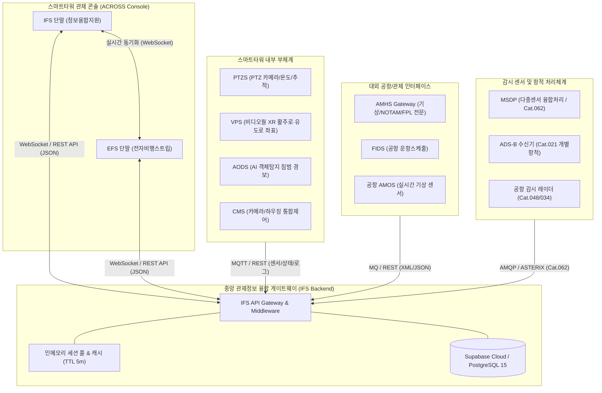
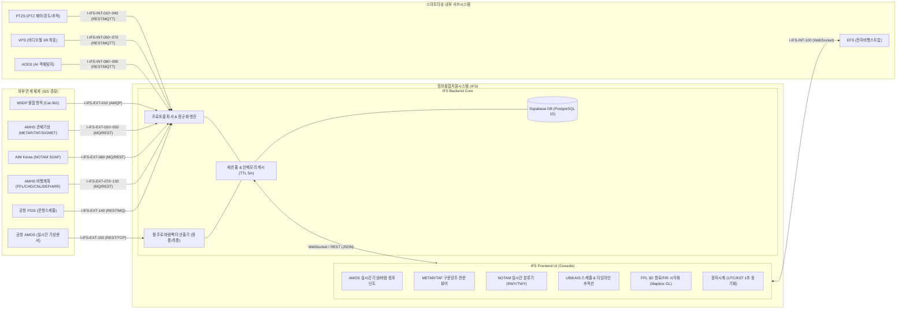

# 스마트타워 정보융합지원시스템
# 인터페이스 설계기술서
### (Information Fusion System Interface Design Description)

**사업명 : 스마트타워(원격타워) 및 실시간 항공교통관리 핵심기술 개발**  
**문서식별번호 : ST-IFS-SYS-IDD-001**  
**발행일자 : 2026.04.14**  

---

> **보안 및 배포 주의사항**  
> 본 문서는 스마트타워/차세대 관제시스템 체계개발 사업 참여기관에 한해 배포되고 사업 수행 목적으로만 사용해야 하며, 작성기관의 사전 승인 없이 본 문서(전부 또는 일부)의 복사, 배포, 사용을 금합니다.

---

### [ 결 재 ]

| 구분 | 소속 | 직책 / 성명 | 일자 | 서명 |
|:---:|:---:|:---:|:---:|:---:|
| **작성** | 대한항공 항공기술연구원 | 책임연구원 정석호 | 2026.04.07 | (인) |
| **작성** | 대한항공 항공기술연구원 | 선임연구원 김정훈 | 2026.04.09 | (인) |
| **검토** | 대한항공 항공기술연구원 | 팀장 정성진 | 2026.04.12 | (인) |
| **승인** | 대한항공 항공우주사업본부 | 상무 김재우 | 2026.04.14 | (인) |

---

### [ 제 / 개정 이력 ]

| 개정번호 | 대상 Page | 개정 이력 요약 | 작성자 | 개정일자 |
|:---:|:---:|:---|:---:|:---:|
| **초안** | ALL | ・신규 작성 (기본 골격 및 외부 연계 프로토콜 정의) | 정석호 | 2026.04.07 |
| **1.0** | ALL | ・외부 연계 인터페이스(AMHS, FIDS, 기상, 항적) 및 내부 서브시스템(PTZS, VPS, AODS, EFS) 연계 규격 구체화 | 김정훈 | 2026.04.09 |
| **1.1** | ALL | ・상세설계검토회의(CDR) 동료검토 결과 반영 (식스스타스 인터페이스 매핑 및 ASTERIX Cat.062/021 규격 표준화) | 김정훈 | 2026.04.14 |

---

# 목 차

**1. 개요**  
&nbsp;&nbsp;1.1 적용범위  
&nbsp;&nbsp;1.2 사업 개요  
&nbsp;&nbsp;1.3 시스템 개요  
&nbsp;&nbsp;1.4 문서 개요  
&nbsp;&nbsp;&nbsp;&nbsp;1.4.1 문서 목적  
&nbsp;&nbsp;&nbsp;&nbsp;1.4.2 문서 내용의 요약  

**2. 관련문서**  
&nbsp;&nbsp;2.1 참고 문헌 및 항공 표준  
&nbsp;&nbsp;2.2 스마트타워 체계 관련 문서  
&nbsp;&nbsp;2.3 정보융합지원시스템(IFS) 관련 문서  

**3. 인터페이스 설계**  
&nbsp;&nbsp;3.1 인터페이스 설계 결정사항  
&nbsp;&nbsp;&nbsp;&nbsp;3.1.1 통신 프로토콜 (REST API, MQTT, AMQP, WebSocket)  
&nbsp;&nbsp;&nbsp;&nbsp;3.1.2 데이터 포맷 (JSON, XML, ASTERIX)  
&nbsp;&nbsp;3.2 인터페이스 식별  
&nbsp;&nbsp;&nbsp;&nbsp;3.2.1 인터페이스 종류 및 분류 기준  
&nbsp;&nbsp;&nbsp;&nbsp;3.2.2 인터페이스 식별자 부여규칙  
&nbsp;&nbsp;&nbsp;&nbsp;3.2.3 인터페이스 관계도  
&nbsp;&nbsp;&nbsp;&nbsp;3.2.4 인터페이스 목록  
&nbsp;&nbsp;&nbsp;&nbsp;&nbsp;&nbsp;3.2.4.1 외부 인터페이스 목록  
&nbsp;&nbsp;&nbsp;&nbsp;&nbsp;&nbsp;3.2.4.2 내부 인터페이스 목록  
&nbsp;&nbsp;&nbsp;&nbsp;3.2.5 외부 인터페이스 상세 설계  
&nbsp;&nbsp;&nbsp;&nbsp;&nbsp;&nbsp;3.2.5.1 융합 항적 (System Track - ASTERIX Cat.062 / JSON)  
&nbsp;&nbsp;&nbsp;&nbsp;&nbsp;&nbsp;3.2.5.2 정시 관제 기상 (METAR)  
&nbsp;&nbsp;&nbsp;&nbsp;&nbsp;&nbsp;3.2.5.3 공항 예보 (TAF)  
&nbsp;&nbsp;&nbsp;&nbsp;&nbsp;&nbsp;3.2.5.4 급변 기상 정보 (SIGMET)  
&nbsp;&nbsp;&nbsp;&nbsp;&nbsp;&nbsp;3.2.5.5 디지털 기상 (IWXXM)  
&nbsp;&nbsp;&nbsp;&nbsp;&nbsp;&nbsp;3.2.5.6 항공고시보 (NOTAM)  
&nbsp;&nbsp;&nbsp;&nbsp;&nbsp;&nbsp;3.2.5.7 제출 비행계획서 (FPL)  
&nbsp;&nbsp;&nbsp;&nbsp;&nbsp;&nbsp;3.2.5.8 비행계획 변경 (CHG)  
&nbsp;&nbsp;&nbsp;&nbsp;&nbsp;&nbsp;3.2.5.9 비행계획 취소 (CNL)  
&nbsp;&nbsp;&nbsp;&nbsp;&nbsp;&nbsp;3.2.5.10 비행 지연 (DLA)  
&nbsp;&nbsp;&nbsp;&nbsp;&nbsp;&nbsp;3.2.5.11 출발 통보 (DEP)  
&nbsp;&nbsp;&nbsp;&nbsp;&nbsp;&nbsp;3.2.5.12 도착 통보 (ARR)  
&nbsp;&nbsp;&nbsp;&nbsp;&nbsp;&nbsp;3.2.5.13 AMHS 전송 결과 보고 (IPN / Report)  
&nbsp;&nbsp;&nbsp;&nbsp;&nbsp;&nbsp;3.2.5.14 운항스케줄 정보 (FIDS / UBIKAIS)  
&nbsp;&nbsp;&nbsp;&nbsp;&nbsp;&nbsp;3.2.5.15 공항 활주로 기상 센서 정보 (AMOS 실시간 풍향/풍속/RVR)  
&nbsp;&nbsp;&nbsp;&nbsp;3.2.6 내부 인터페이스 상세 설계  
&nbsp;&nbsp;&nbsp;&nbsp;&nbsp;&nbsp;3.2.6.1 PTZS 카메라 상태 및 Health Check  
&nbsp;&nbsp;&nbsp;&nbsp;&nbsp;&nbsp;3.2.6.2 PTZS 시스템 Error Log  
&nbsp;&nbsp;&nbsp;&nbsp;&nbsp;&nbsp;3.2.6.3 PTZS 하우징 온도센서 정보  
&nbsp;&nbsp;&nbsp;&nbsp;&nbsp;&nbsp;3.2.6.4 PTZS 자동 추적 항적 데이터  
&nbsp;&nbsp;&nbsp;&nbsp;&nbsp;&nbsp;3.2.6.5 VPS 활주로·유도로 영역 좌표  
&nbsp;&nbsp;&nbsp;&nbsp;&nbsp;&nbsp;3.2.6.6 VPS 상태 및 Health Check  
&nbsp;&nbsp;&nbsp;&nbsp;&nbsp;&nbsp;3.2.6.7 VPS 시스템 Error Log  
&nbsp;&nbsp;&nbsp;&nbsp;&nbsp;&nbsp;3.2.6.8 AODS 상태 및 Health Check  
&nbsp;&nbsp;&nbsp;&nbsp;&nbsp;&nbsp;3.2.6.9 AODS 시스템 Error Log  
&nbsp;&nbsp;&nbsp;&nbsp;&nbsp;&nbsp;3.2.6.10 EFS 전자비행스트립 연계 동기화  
&nbsp;&nbsp;&nbsp;&nbsp;&nbsp;&nbsp;3.2.6.11 공항 관제 지시 및 공지사항(Notices) 동기화  
&nbsp;&nbsp;&nbsp;&nbsp;&nbsp;&nbsp;3.2.6.12 실시간 활주로 바람 성분(정풍·배풍·측풍) 산출 정보  
&nbsp;&nbsp;&nbsp;&nbsp;&nbsp;&nbsp;3.2.6.13 비행계획 3D 궤적(Waypoint/FIR) 표출 정보  
&nbsp;&nbsp;&nbsp;&nbsp;&nbsp;&nbsp;3.2.6.14 IFS 시스템 Health Check & Heartbeat  
&nbsp;&nbsp;3.3 인터페이스 식별자 정리  
&nbsp;&nbsp;&nbsp;&nbsp;3.3.1 외부 인터페이스 식별자 요약  
&nbsp;&nbsp;&nbsp;&nbsp;3.3.2 내부 인터페이스 식별자 요약  

**4. 요구사항 추적성**  

**5. 참고사항 (제약사항, 제한사항 등)**  
&nbsp;&nbsp;5.1 시스템 환경 제약사항  
&nbsp;&nbsp;5.2 성능 요구사항  
&nbsp;&nbsp;5.3 외부 연동 제약사항  
&nbsp;&nbsp;5.4 단위 변환 기준  

**부록 A. 용어정의**  

---

### [ 그림 목차 ]
* **그림 1.** 스마트타워 체계 및 IFS 시스템 구성도
* **그림 2.** IFS 내·외부 인터페이스 관계도

### [ 표 목차 ]
* **표 1.** 스마트타워 시스템 구성요소 및 역할
* **표 2.** 문서 내용 요약
* **표 3.** 인터페이스 식별자 부여 형식
* **표 4.** 문서 식별자명
* **표 5.** 인터페이스 영역 식별자명
* **표 6.** IFS 외부 인터페이스 목록
* **표 7.** IFS 내부 인터페이스 목록
* **표 8.** IFS 외부 인터페이스 식별자 일람
* **표 9.** IFS 내부 인터페이스 식별자 일람
* **표 10.** 인터페이스 요구사항 추적성 매트릭스
* **표 11.** 단위 변환 기준 정리
* **표 12.** 항공 및 시스템 용어 정의

---

## 1. 개요

### 1.1 적용범위
본 문서는 국토교통부 스마트타워(원격타워) 및 차세대 항공교통관리 핵심기술 개발 사업의 일환으로 수행되는 **정보융합지원시스템(Information Fusion System, 이하 IFS)**의 체계 인터페이스를 기술한 문서이다. 스마트타워 체계를 구성하는 카메라/영상/감시 서브시스템(PTZS, VPS, AODS, CMS, MSDP, SIS) 및 전자비행스트립(EFS)과의 내부 연동 규격뿐만 아니라, 항공고정통신망(AMHS), 공항운항정보시스템(FIDS), 공항기상관측시스템(AMOS), 항공기상청(AMO), 비행정보포털(UBIKAIS) 등 외부 체계와의 데이터 교환 기준을 정의한다.

### 1.2 사업 개요
항공교통량 증가와 지방공항 원격 통합관제 환경 전환에 대응하기 위하여, 고화질 광학 파노라마 영상, 열화상/PTZ 지향 카메라, 다중센서 융합항적, 실시간 관제기상, 공항시설고시(NOTAM), 운항스케줄, 비행계획서를 단일 화면에 유기적으로 통합·표출하는 차세대 스마트타워 관제 환경 구축이 필수적이다.
본 사업을 통해 개발되는 스마트타워 관제 콘솔은 관제사의 인지 과부하(Cognitive Overload)를 대폭 경감하고 상황인식(Situational Awareness) 능력을 극대화하는 것을 목적으로 한다.

### 1.3 시스템 개요
IFS는 대한항공 ACROSS 플랫폼을 기반으로 구축된 전술 관제정보 융합 단말 시스템이다. 이기종 시스템들로부터 수집된 항공 기상, NOTAM, 스케줄, 비행계획, 감시 항적, 지상 감시 센서 정보를 단일 인터페이스로 통합 제공한다.

#### <표 1> 시스템 구성요소 및 역할
| 구성요소 | 코드 | 역할 |
|:---|:---:|:---|
| **Panorama Camera Housing System** | PCHS | 파노라마 카메라 하우징 환경 제어 (와이퍼, 발열패드, 팬) |
| **PTZ Camera System** | PTZS | 고배율 PTZ 카메라 제어, 자동 표적 추적, 하우징 온도 감시 |
| **Video Presentation System** | VPS | 대형 비디오월 파노라마 영상 및 XR 오버레이 표출 |
| **Airfield Object Detection System** | AODS | AI 딥러닝 기반 항공기/차량/인원 실시간 객체 탐지 및 침범 분석 |
| **Control & Management System** | CMS | 관제 콘솔 입력장치(와콤 태블릿, 조이스틱)를 통한 카메라/센서 통합 제어 |
| **Information Fusion System** | **IFS** | **종합 관제정보(기상, NOTAM, 스케줄, FPL, 공지) 실시간 융합 표출 단말** |
| **Electronic Flight Strip System** | EFS | 터치 기반 실시간 전자비행스트립 관제단말 |
| **Tower-Based Advisory System** | TBAS | 활주로 침범 경고 및 타워 전술 안전 조언 시스템 |
| **Multi-Sensor Data Processor** | MSDP | ADS-B, Radar, MLAT, A-SMGCS 다중센서 항적 융합 처리기 |
| **Surveillance & Info Interface Server** | SIS | AMHS, FIDS, 공항기상, 외부 센서 연계 게이트웨이 |


**<그림 1> 스마트타워 체계 및 IFS 시스템 구성도**

### 1.4 문서 개요

#### 1.4.1 문서 목적
본 인터페이스 설계기술서는 스마트타워 체계 내에서 정보융합지원시스템(IFS)이 연동하는 내부 서브시스템 간, 그리고 대외 항공교통 연계 시스템 간의 인터페이스 데이터 항목, 통신 규격, 프로토콜, 데이터 구조를 명확히 정의하는 것을 목적으로 하며, 문서식별자는 `ST-IFS-SYS-IDD-001`로 정의한다.

#### 1.4.2 문서 내용의 요약
#### <표 2> 문서 내용 요약
| 구 분 | 내 용 |
|:---|:---|
| **1. 개요** | 체계 및 소프트웨어 식별, 사업 개요 및 시스템 아키텍처 기술 |
| **2. 관련문서** | 국내외 법령, ICAO 표준, 스마트타워 체계 관련 설계 문서 명시 |
| **3. 인터페이스 설계** | 통신 프로토콜, 포맷, 식별자 규칙, 관계도 및 내·외부 인터페이스 상세 정의 (29종) |
| **4. 요구사항 추적성** | 체계요구사항(SSRS), SW요구사항(SRS), SW설계(SDD) 간 추적성 매트릭스 기술 |
| **5. 참고사항** | 시스템 환경, 성능 한계치, 외부 연동 제약사항, 단위 변환 기준 기술 |
| **부록 A. 용어정의** | 항공교통관제(ATC/ATM) 및 스마트타워 도메인 표준 전문 용어 정의 |

---

## 2. 관련문서

### 2.1 참고 문헌 및 항공 표준
1. 국토교통부, "한국형 도심항공교통(K-UAM) 운용개념서 1.5", 2025년 8월.
2. 국토교통부 항공교통본부, "항공교통관제절차 및 통신 표준 교범", 2024년.
3. ICAO Doc 4444 ATM/501, "Procedures for Air Navigation Services – Air Traffic Management", 16th Edition.
4. ICAO Annex 3, "Meteorological Service for International Air Navigation", 20th Edition.
5. ICAO Annex 15, "Aeronautical Information Services", 16th Edition.
6. EUROCONTROL, "EUROCONTROL Standard Document for Surveillance Data Exchange - ASTERIX Part 9 (Cat.062) & Part 12 (Cat.021)", 2023년.
7. RTCA DO-278A / EUROCAE ED-109A, "Guidelines for Communication, Navigation, Surveillance, and Air Traffic Management (CNS/ATM) Systems Software Integrity Assurance", AL4 Compliance.

### 2.2 스마트타워 체계 관련 문서
1. `ST-SYS-OCD-001` 스마트타워 체계 운용개념 기술서
2. `ST-SYS-SSRS-001` 스마트타워 체계 요구사항 명세서
3. `ST-SYS-SSDD-001` 스마트타워 체계 설계 기술서
4. `ST-SYS-IDD-001` 스마트타워 체계 인터페이스 설계 기술서

### 2.3 정보융합지원시스템(IFS) 관련 문서
1. `ST-IFS-SRS-001` IFS 소프트웨어 요구사항 명세서
2. `ST-IFS-SDD-001` IFS 소프트웨어 설계 기술서
3. `ST-IFS-DBDD-001` IFS 데이터베이스 설계 기술서

---

## 3. 인터페이스 설계

### 3.1 인터페이스 설계 결정사항

#### 3.1.1 통신 프로토콜
1. **REST API (HTTP/HTTPS)**:
   - 클라이언트(IFS UI)와 게이트웨이(IFS Backend), 외부 정적 시스템(FIDS, AMOS, UBIKAIS, Supabase) 간의 동기식 요청/응답(Req/Res) 트랜잭션에 적용.
   - 표준 HTTP 상태 코드(200, 400, 404, 500) 및 JSON 기반 에러 핸들링 준수.
2. **MQTT (Message Queuing Telemetry Transport)**:
   - 스마트타워 내부 부체계(PTZS, VPS, AODS, CMS)와의 센서 및 실시간 제어/상태 이벤트 교환에 적용.
   - QoS 레벨 1을 기본 적용하여 센서 및 상태 로그의 유실 방지.
3. **AMQP (Advanced Message Queuing Protocol)**:
   - SIS 및 MSDP를 경유하는 대용량 실시간 융합항적(System Track), AMHS 전문 메시지 큐 연동에 적용.
4. **WebSocket (WSS)**:
   - IFS 백엔드와 프론트엔드 관제 단말 간 실시간 기상/NOTAM/항적 스트리밍에 적용.

#### 3.1.2 데이터 포맷
1. **JSON (JavaScript Object Notation)**:
   - IFS 내·외부 데이터 교환의 표준 형식. 경량성과 파싱 효율성 확보.
2. **XML (AMHS / ICAO Formats)**:
   - AMHS 게이트웨이를 통해 수신되는 METAR, TAF, SIGMET, NOTAM, ICAO FPL 전문 교환에 적용.
3. **ASTERIX (All-purpose Structured Eurocontrol Surveillance Information Exchange)**:
   - 다중센서 융합항적(Cat.062) 및 ADS-B(Cat.021) 바이너리 데이터를 JSON으로 파싱하여 IFS에 표출.

---

### 3.2 인터페이스 식별

#### 3.2.1 인터페이스 종류 및 분류 기준
1. **시스템 연동 경계**:
   - 외부 인터페이스 (`EXT`): 스마트타워 SIS를 통해 외부 항공망(AMHS, FIDS, AMOS, MSDP)과 연계되는 인터페이스.
   - 내부 인터페이스 (`INT`): 스마트타워 내부 부체계(PTZS, VPS, AODS, EFS) 및 IFS UI-Backend 간 발생하는 인터페이스.
2. **데이터 흐름 방향**:
   - 송신 (TX): IFS에서 타 시스템으로 상태/동기화 데이터를 전송.
   - 수신 (RX): 타 시스템 또는 센서로부터 정보를 취합하여 IFS로 수신.
3. **발생 주기**:
   - 주기 기반: 1초(항적, 센서), 1분(스케줄), 30분/1시간(METAR).
   - 이벤트 기반: FPL 제출/변경, NOTAM 발행, 에러 로그 발생.

#### 3.2.2 인터페이스 식별자 부여규칙
#### <표 3> 식별자 부여 형식
| 식별자 형식 | `문서식별자 - 시스템식별자 - 인터페이스영역 - 일련번호` |
|:---|:---|
| **식별자 예시** | `I-IFS-EXT-010`, `I-IFS-INT-010` |

#### <표 4> 문서 식별자명
| 구 분 | 식별자 | 비 고 |
|:---:|:---:|:---|
| **인터페이스** | **I** | Interface (for IDD) |
| **체계 요구사항** | **SR** | System Requirement (for SSRS) |
| **SW 요구사항** | **R** | Software Requirement (for SRS) |
| **SW 설계** | **D** | Software Description (for SDD) |

#### <표 5> 인터페이스 영역 식별자명
| 인터페이스 영역 | 식별자 | 비 고 |
|:---:|:---:|:---|
| **외부 연동** | **EXT** | External Interface (외부 항공망, SIS, AMHS, FIDS) |
| **내부 연동** | **INT** | Internal Interface (PTZS, VPS, AODS, EFS, IFS 내부) |

---

### 3.2.3 인터페이스 관계도


**<그림 2> IFS 인터페이스 관계도**

---

### 3.2.4 인터페이스 목록

#### 3.2.4.1 외부 인터페이스 목록
#### <표 6> 외부 인터페이스 목록
| # | 인터페이스명 | 프로토콜 | 주기 | 포맷 | 송신자 | 수신자 | 설명 |
|:---:|:---|:---:|:---:|:---:|:---:|:---:|:---|
| 1 | 융합 항적 (System Track) | AMQP | 1Hz | JSON / Cat.062 | SIS (MSDP) | IFS | MSDP에서 생성된 Cat.062 기반 통합항적 |
| 2 | 정시 관제 기상 (METAR) | MQ/REST | 30분/1시간 | XML / JSON | SIS (AMHS) | IFS | 공항별 정시 관제 기상 전문 |
| 3 | 공항 예보 (TAF) | MQ/REST | 6시간 | XML / JSON | SIS (AMHS) | IFS | 공항 운항 예보 기상 전문 |
| 4 | 급변 기상 정보 (SIGMET) | MQ/REST | Event | XML / JSON | SIS (AMHS) | IFS | 공역 내 위험 기상 경보 |
| 5 | 디지털 기상 (IWXXM) | MQ/REST | Event | XML (GML) | SIS (AMHS) | IFS | ICAO 차세대 디지털 기상 포맷 |
| 6 | 항공고시보 (NOTAM) | MQ/REST | Event | XML SOAP | SIS (AIM) | IFS | 실시간 시설/활주로/공역 고시보 |
| 7 | 제출 비행계획서 (FPL) | MQ/REST | Event | XML IPM | SIS (AMHS) | IFS | ICAO Doc 4444 표준 제출 비행계획서 |
| 8 | 비행계획 변경 (CHG) | MQ/REST | Event | XML IPM | SIS (AMHS) | IFS | 기 제출된 비행계획 변동 내역 |
| 9 | 비행계획 취소 (CNL) | MQ/REST | Event | XML SOAP | SIS (AMHS) | IFS | 비행계획 취소 전문 |
| 10 | 비행 지연 (DLA) | MQ/REST | Event | XML SOAP | SIS (AMHS) | IFS | 비행 출발 지연 통보 |
| 11 | 출발 통보 (DEP) | MQ/REST | Event | XML SOAP | SIS (AMHS) | IFS | 실제 이륙 및 출발 통보 전문 |
| 12 | 도착 통보 (ARR) | MQ/REST | Event | XML SOAP | SIS (AMHS) | IFS | 실제 착륙 및 도착 통보 전문 |
| 13 | 전송 결과 보고 (IPN) | MQ/REST | Event | XML SOAP | SIS (AMHS) | IFS | AMHS 메시지 전달 및 수신 결과 보고 |
| 14 | 운항스케줄 정보 (FIDS) | REST/MQ | 1분/Event | JSON | SIS (FIDS) | IFS | 공항 종합 출발/도착 운항스케줄 |
| 15 | 공항 기상 센서 정보 (AMOS)| REST/TCP | 1초 | JSON | 공항 AMOS | IFS | 활주로별 2분/10분 평균 풍향·풍속·기온·RVR |

#### 3.2.4.2 내부 인터페이스 목록
#### <표 7> 내부 인터페이스 목록
| # | 인터페이스명 | 프로토콜 | 주기 | 포맷 | 송신자 | 수신자 | 설명 |
|:---:|:---|:---:|:---:|:---:|:---:|:---:|:---|
| 1 | PTZS 상태 및 Health Check | REST API | 1초 | JSON | PTZS | IFS | PTZ 카메라 서브시스템 생존 상태 체크 |
| 2 | PTZS 시스템 Error Log | MQTT | Event | JSON | PTZS | IFS | PTZ 구동 모터 및 렌즈 장애 로그 수신 |
| 3 | PTZS 하우징 온도센서 정보 | MQTT | 1초 | JSON | PTZS | IFS | 실시간 하우징 내부/외부 온도 모니터링 |
| 4 | PTZS 자동 추적 항적 데이터 | MQTT | 1초 | JSON | PTZS | IFS | PTZ 카메라 시각 추적 표적 좌표 |
| 5 | VPS 활주로·유도로 영역 좌표 | MQTT | Event | JSON | VPS | IFS | 비디오월 XR 오버레이 영역 좌표 수신 |
| 6 | VPS 상태 및 Health Check | REST API | 1초 | JSON | VPS | IFS | 비디오월 렌더러 서버 생존 상태 체크 |
| 7 | VPS 시스템 Error Log | MQTT | Event | JSON | VPS | IFS | 비디오월 표출 엔진 장애 로그 수신 |
| 8 | AODS 상태 및 Health Check | REST API | 1초 | JSON | AODS | IFS | AI 객체 탐지 서버 생존 상태 체크 |
| 9 | AODS 시스템 Error Log | MQTT | Event | JSON | AODS | IFS | 딥러닝 추론 엔진 장애 로그 수신 |
| 10 | EFS 스트립 연계 동기화 | WebSocket | Event | JSON | IFS | EFS | 비행계획 승인/출도착 상태 스트립 동기화 |
| 11 | 관제 지시 및 공지사항 동기화 | REST/WSS | Event | JSON | IFS | Supabase | 관제탑 일일 공지 및 지시문 실시간 동기화 |
| 12 | 실시간 활주로 바람 성분 정보 | WebSocket | 1초 | JSON | IFS Backend| IFS UI | 활주로별 정풍·배풍·측풍 벡터 자동 계산 분해 |
| 13 | 비행계획 3D 궤적 표출 정보 | REST/JSON | Event | JSON | IFS Backend| IFS UI | ICAO FPL 파싱 기반 3D 웨이포인트/FIR 맵 |
| 14 | IFS 시스템 Health Check | REST/WSS | 1초 | JSON | IFS UI | Backend | 관제단말 화면-서버 간 통합 심박(Heartbeat) |

---

### 3.2.5 외부 인터페이스 상세 설계

#### 3.2.5.1 융합 항적 (System Track)
* **인터페이스 식별자**: `I-IFS-EXT-010`
* **인터페이스명**: 융합 항적 (System Track Data)
* **통신 프로토콜**: AMQP / TCP
* **데이터 포맷**: JSON (ASTERIX Cat.062 표준 기반 변환)
* **발생 주기**: 1Hz 주기
* **연계 방식**: Message Queue (Pub/Sub)
* **송신자 / 수신자**: SIS (MSDP) ──► IFS Backend

##### [데이터 필드 구조]
| 영문컬럼명 | 한글컬럼명 | 데이터형 | 필수/선택 | 설명 및 유효범위 |
|:---|:---|:---:|:---:|:---|
| `trackNumber` | 항적 식별번호 | Integer | M | 고유 트랙 번호 (1 ~ 65535) |
| `targetAddress`| ICAO 24비트 주소 | String | M | 6자리 16진수 항공기 고유 주소 (예: "71CE88") |
| `callsign` | 항공기 호출부호 | String | M | 항공기 편명 (예: "KAL1234", 최대 8자리) |
| `mode3ACode` | Mode 3/A 스쿽코드 | String | M | 4자리 8진수 트랜스폰더 코드 (0000 ~ 7777) |
| `latitude` | WGS84 위도 | Double | M | -90.0 ~ +90.0 (도, 소수점 6자리) |
| `longitude` | WGS84 경도 | Double | M | -180.0 ~ +180.0 (도, 소수점 6자리) |
| `geometricAltitude`| 기하학적 고도 | Double | M | WGS84 기준 타원체고 (단위: ft, 해상도 6.25 ft) |
| `barometricAltitude`| 기압 고도 | Double | M | 표준 QNH 보정 기압고도 (단위: ft) |
| `groundSpeed` | 대지 속도 | Double | M | 지표면 기준 수평 속도 (단위: Knot) |
| `trackAngle` | 진행 방향각 | Double | M | 진북 기준 시계방향 방위각 (0.0 ~ 359.9°) |
| `verticalRate` | 상승/하강률 | Double | M | 수직 속도 (+: 상승, -: 하강, 단위: ft/min) |
| `trackStatus` | 항적 상태 플래그 | Object | M | 융합 센서 상태 (mono/multi, confirmed, coasted) |
| `timeOfTrack` | 항적 측정 시간 | String | M | UTC 타임스탬프 (ISO 8601 형식) |

##### [샘플 데이터 (JSON)]
```json
{
  "trackNumber": 1042,
  "targetAddress": "71C2E4",
  "callsign": "KAL1102",
  "mode3ACode": "1254",
  "latitude": 37.469215,
  "longitude": 126.440582,
  "geometricAltitude": 2500.0,
  "barometricAltitude": 2480.0,
  "groundSpeed": 165.4,
  "trackAngle": 154.2,
  "verticalRate": -750.0,
  "trackStatus": {
    "isMultiSensor": true,
    "confidence": "CONFIRMED",
    "altitudeSource": "GNSS"
  },
  "timeOfTrack": "2026-04-14T06:12:30.500Z"
}
```

---

#### 3.2.5.2 정시 관제 기상 (METAR)
* **인터페이스 식별자**: `I-IFS-EXT-020`
* **인터페이스명**: 정시 관제 기상 (METAR / SPECI)
* **통신 프로토콜**: MQ / REST API (HTTPS)
* **데이터 포맷**: XML (AMHS IPM) / JSON
* **발생 주기**: 30분 또는 1시간 주기 (SPECI는 변동 시 즉시)
* **송신자 / 수신자**: SIS (AMHS Gateway) ──► IFS

##### [데이터 필드 구조]
| 영문컬럼명 | 한글컬럼명 | 데이터형 | 필수/선택 | 설명 및 유효범위 |
|:---|:---|:---:|:---:|:---|
| `stationId` | 공항 ICAO 코드 | String | M | 대상 비행장 식별 부호 (예: "RKSI", "RKSS") |
| `issueTime` | 관측 발표 일시 | String | M | 관측 일시 (ISO 8601 UTC) |
| `rawText` | METAR 원문 전문 | String | M | ICAO Annex 3 표준 관측 원문 |
| `windDirection`| 풍향 (도) | Integer | M | 0 ~ 360° (0: 정온/VRB) |
| `windSpeed` | 풍속 (Knot) | Integer | M | 관측 풍속 (단위: Knot) |
| `windGust` | 돌풍 (Knot) | Integer | O | 최대 돌풍 속도 (단위: Knot, 생략 가능) |
| `visibility` | 시정 (미터) | Integer | M | 지표면 수평 시정 (단위: m, 9999=10km 이상) |
| `rvr` | 활주로 가시거리 | Array | O | 활주로별 RVR 배열 (예: [{"rwy": "15R", "vis": 1200}]) |
| `presentWeather`| 현재 기상 현상 | String | O | 기상 부호 (예: "-RA", "FG", "BR", "TS") |
| `cloudLayers` | 운량 및 운고 | Array | M | 구름 계층 배열 (FEW, SCT, BKN, OVC 및 운고 ft) |
| `temperature` | 기온 (°C) | Double | M | 섭씨 온도 |
| `dewPoint` | 이슬점 (°C) | Double | M | 섭씨 이슬점 온도 |
| `altimeter` | QNH 기압 (hPa) | Double | M | 표준 고도계 수정치 (해면기압, hPa) |

##### [샘플 데이터 (JSON)]
```json
{
  "stationId": "RKSI",
  "issueTime": "2026-04-14T06:00:00Z",
  "rawText": "METAR RKSI 140600Z 32014G25KT 9999 FEW025 BKN080 16/04 Q1018 NOSIG=",
  "windDirection": 320,
  "windSpeed": 14,
  "windGust": 25,
  "visibility": 9999,
  "rvr": [],
  "presentWeather": null,
  "cloudLayers": [
    { "coverage": "FEW", "altitude": 2500 },
    { "coverage": "BKN", "altitude": 8000 }
  ],
  "temperature": 16.0,
  "dewPoint": 4.0,
  "altimeter": 1018.0
}
```

---

#### 3.2.5.6 항공고시보 (NOTAM)
* **인터페이스 식별자**: `I-IFS-EXT-060`
* **인터페이스명**: 항공고시보 (NOTAM)
* **통신 프로토콜**: MQ / REST API (HTTPS)
* **데이터 포맷**: XML SOAP / JSON
* **발생 주기**: Event 기반 (신규 발행, 수정, 취소 시)
* **송신자 / 수신자**: SIS (AIM Korea) ──► IFS

##### [데이터 필드 구조]
| 영문컬럼명 | 한글컬럼명 | 데이터형 | 필수/선택 | 설명 및 유효범위 |
|:---|:---|:---:|:---:|:---|
| `notamNumber` | NOTAM 일련번호 | String | M | 고유 식별자 (예: "A0412/26", "C0105/26") |
| `location` | 대상 위치 코드 | String | M | 공항 ICAO 코드 또는 FIR 코드 (예: "RKSI", "RKRR") |
| `series` | 시리즈 구분 | String | M | "A" (국제), "C" (국내) |
| `qCode` | ICAO Q코드 | String | M | 5자리 분류 코드 (예: "QMRLC", "QFAXX") |
| `qCodeMeaning`| Q코드 한글 해석 | String | M | 표준 번역 의미 (예: "활주로 폐쇄", "공항 운영시간 변경") |
| `scope` | 영향 범위 | String | M | "A" (공항), "E" (항로), "W" (항행경고) |
| `effectiveStart`| 유효 시작 일시 | String | M | ISO 8601 UTC 일시 |
| `effectiveEnd` | 유효 종료 일시 | String | M | ISO 8601 UTC 일시 또는 "PERM" |
| `category` | IFS 자동 분류 | String | M | "RWY_TWY", "LIGHT", "AIRSPACE", "NAV", "GENERAL" |
| `fullText` | NOTAM 원문 | String | M | ICAO 표준 전문 텍스트 |
| `summary` | 한글 요약문 | String | M | 항목 E 파싱 요약문 |

##### [샘플 데이터 (JSON)]
```json
{
  "notamNumber": "A0412/26",
  "location": "RKSI",
  "series": "A",
  "qCode": "QMRLC",
  "qCodeMeaning": "활주로 폐쇄 (Runway Closed)",
  "scope": "A",
  "effectiveStart": "2026-04-14T14:00:00Z",
  "effectiveEnd": "2026-04-14T22:00:00Z",
  "category": "RWY_TWY",
  "fullText": "A0412/26 NOTAMN\nQ) RKRR/QMRLC/IV/NBO/A/000/999/3728N12626E005\nA) RKSI B) 2604141400 C) 2604142200\nE) RWY 15R/33L CLSD DUE TO MAINT.",
  "summary": "15R/33L 활주로 유지보수 작업으로 인한 야간 임시 폐쇄"
}
```

---

#### 3.2.5.7 제출 비행계획서 (FPL)
* **인터페이스 식별자**: `I-IFS-EXT-070`
* **인터페이스명**: 제출 비행계획서 (Filed Flight Plan)
* **통신 프로토콜**: MQ / REST API
* **데이터 포맷**: XML (AMHS IPM) / JSON
* **발생 주기**: Event 기반
* **송신자 / 수신자**: SIS (AMHS Gateway) ──► IFS

##### [데이터 필드 구조]
| 영문컬럼명 | 한글컬럼명 | 데이터형 | 필수/선택 | 설명 |
|:---|:---|:---:|:---:|:---|
| `gufi` | 비행 고유 식별자 | String | M | UUID 형식 글로벌 비행 고유키 |
| `aircraftId` | 항공기 편명 | String | M | 호출부호 (예: "KAL1234") |
| `aircraftType` | 항공기 기종 | String | M | ICAO 기종 코드 (예: "B77W", "A359", "B738") |
| `wakeTurbulence`| 후류 난기류 카테고리| String | M | "H" (Heavy), "M" (Medium), "L" (Light) |
| `flightRules` | 비행 규칙 | String | M | "I" (IFR), "V" (VFR), "Y", "Z" |
| `flightType` | 비행 유형 | String | M | "S" (Scheduled), "N" (Non-scheduled), "G" (General) |
| `departure` | 출발 공항 | String | M | ICAO 4자리 코드 (예: "RKSI") |
| `destination` | 목적지 공항 | String | M | ICAO 4자리 코드 (예: "RKPK") |
| `eobt` | 예상 출발 시각 | String | M | Estimated Off-Block Time (ISO 8601 UTC) |
| `cruisingSpeed` | 순항 속도 | String | M | 예: "N0460" (460 Knot) |
| `cruisingLevel` | 순항 고도 | String | M | 예: "F310" (FL310) |
| `route` | 비행 계획 항로 | String | M | 웨이포인트 및 항공로 (예: "EGOBA Y644 BULTI") |
| `eet` | 총 비행 소요 시간 | String | M | 예: "0050" (50분) |
| `alternate` | 교체 비행장 | String | O | 1/2 교체 비행장 ICAO 코드 |

---

#### 3.2.5.14 운항스케줄 정보 (FIDS / UBIKAIS)
* **인터페이스 식별자**: `I-IFS-EXT-140`
* **인터페이스명**: 공항 운항스케줄 (Flight Information Display System)
* **통신 프로토콜**: REST API (HTTPS) / MQ
* **데이터 포맷**: JSON
* **발생 주기**: 1분 주기 동기화 및 변동 시 Event
* **송신자 / 수신자**: SIS (FIDS Gateway / UBIKAIS) ──► IFS

##### [데이터 필드 구조]
| 영문컬럼명 | 한글컬럼명 | 데이터형 | 필수/선택 | 설명 |
|:---|:---|:---:|:---:|:---|
| `flightType` | 출발/도착 구분 | String | M | "DEP" (출발), "ARR" (도착) |
| `airline` | 항공사 명칭/코드 | String | M | 예: "대한항공", "KAL" |
| `flightNumber` | 편명 | String | M | 예: "KE1234" |
| `aircraftType` | 투입 기종 | String | M | 예: "A220-300" |
| `registration` | 항공기 등록기호 | String | O | 예: "HL8314" |
| `airport` | 상대 공항 | String | M | 출발지 또는 목적지 공항 ICAO/IATA 코드 |
| `stand` | 주기장 번호 | String | O | 배정 스탠드/게이트 (예: "Gate 12", "Spot 34") |
| `scheduleTime` | 예정 시각 | String | M | STD (출발예정) 또는 STA (도착예정) |
| `estimatedTime`| 예상 시각 | String | O | ETD (예상출발) 또는 ETA (예상도착) |
| `actualTime` | 실제 시각 | String | O | ATD (실제이륙) 또는 ATA (실제착륙) |
| `flightStatus` | 운항 상태 | String | M | "정상", "지연", "결항", "출발", "도착" |

##### [샘플 데이터 (JSON)]
```json
[
  {
    "flightType": "DEP",
    "airline": "대한항공",
    "flightNumber": "KE1211",
    "aircraftType": "B737-900",
    "registration": "HL7724",
    "airport": "RKPC",
    "stand": "Spot 114",
    "scheduleTime": "2026-04-14T07:10:00Z",
    "estimatedTime": "2026-04-14T07:15:00Z",
    "actualTime": null,
    "flightStatus": "탑승중"
  }
]
```

---

#### 3.2.5.15 공항 기상 센서 정보 (AMOS)
* **인터페이스 식별자**: `I-IFS-EXT-150`
* **인터페이스명**: 공항 기상 센서 정보 (Automated Meteorological Observing System)
* **통신 프로토콜**: REST API (HTTPS) / TCP Stream
* **데이터 포맷**: JSON
* **발생 주기**: 1초 주기
* **송신자 / 수신자**: 공항 기상센서 (AMOS) ──► IFS Backend

##### [데이터 필드 구조]
| 영문컬럼명 | 한글컬럼명 | 데이터형 | 필수/선택 | 설명 |
|:---|:---|:---:|:---:|:---|
| `airportIcao` | 공항 ICAO 코드 | String | M | 관측 공항 식별 부호 (예: "RKSI") |
| `timestamp` | 관측 시각 | String | M | ISO 8601 UTC 일시 |
| `magWindDir` | 2분 평균 자방위 풍향| Integer | M | 관제탑용 자방위 기준 풍향 (0 ~ 360°) |
| `trueWindDir` | 10분 평균 진방위 풍향| Integer | M | 예보용 진방위 기준 풍향 (0 ~ 360°) |
| `windSpeed` | 풍속 (Knot) | Double | M | 현재 측정 풍속 (단위: Knot) |
| `peakGust` | 순간 최대 돌풍 | Double | O | 최근 10분 내 돌풍 속도 (단위: Knot) |
| `rwySensors` | 활주로별 센서 데이터| Array | M | 활주로 말단(TDZ, MID, END)별 풍향/풍속/RVR |
| `temperature` | 기온 (°C) | Double | M | 소수점 1자리 섭씨온도 |
| `qnh` | 현지 기압 (hPa) | Double | M | 관제 고도계 세팅 기압 |

---

### 3.2.6 내부 인터페이스 상세 설계

#### 3.2.6.1 PTZS 카메라 상태 및 Health Check
* **인터페이스 식별자**: `I-IFS-INT-010`
* **인터페이스명**: PTZS 상태 및 Health Check
* **통신 프로토콜**: REST API (GET)
* **데이터 포맷**: JSON
* **발생 주기**: 1초 주기
* **송신자 / 수신자**: PTZS ──► IFS

##### [데이터 필드 구조]
| 영문컬럼명 | 한글컬럼명 | 데이터형 | 필수/선택 | 설명 |
|:---|:---|:---:|:---:|:---|
| `systemId` | 서브시스템 코드 | String | M | "PTZS-01", "PTZS-02" 등 |
| `status` | 동작 상태 | String | M | "HEALTHY", "DEGRADED", "ERROR" |
| `panAngle` | 현재 수평각 (Pan) | Double | M | -180.0 ~ +180.0 (도) |
| `tiltAngle` | 현재 수직각 (Tilt)| Double | M | -90.0 ~ +90.0 (도) |
| `zoomLevel` | 현재 줌 배율 | Double | M | 광학 줌 배율 (1.0x ~ 40.0x) |
| `trackingMode` | 자동추적 활성화 여부| Boolean | M | true: 추적 중, false: 수동 대기 |
| `lastHeartbeat`| 최종 응답 시간 | String | M | ISO 8601 UTC 타임스탬프 |

---

#### 3.2.6.5 VPS 활주로·유도로 영역 좌표
* **인터페이스 식별자**: `I-IFS-INT-050`
* **인터페이스명**: VPS 활주로·유도로 영역 좌표
* **통신 프로토콜**: MQTT (Topic: `vps/xr/coordinates`)
* **데이터 포맷**: JSON
* **발생 주기**: Event 기반 (XR 레이어 ON 및 영역 편집 시)
* **송신자 / 수신자**: VPS ──► IFS

##### [데이터 필드 구조]
| 영문컬럼명 | 한글컬럼명 | 데이터형 | 필수/선택 | 설명 |
|:---|:---|:---:|:---:|:---|
| `airportIcao` | 대상 공항 코드 | String | M | 예: "RKSI", "RKPU" |
| `zoneType` | 영역 분류 | String | M | "RUNWAY", "TAXIWAY", "APRON", "STOP_BAR" |
| `zoneIdentifier`| 구역 식별 부호 | String | M | 예: "RWY-15R", "TWY-A2" |
| `polygonCoords` | 경계 3D 좌표 목록 | Array | M | 위도/경도/고도 폴리곤 정점 배열 |
| `status` | 점유 및 운영 상태 | String | M | "ACTIVE", "CLOSED", "HOLDING" |

---

#### 3.2.6.10 EFS 전자비행스트립 연계 동기화
* **인터페이스 식별자**: `I-IFS-INT-100`
* **인터페이스명**: EFS 전자비행스트립 연계 동기화
* **통신 프로토콜**: WebSocket (WSS)
* **데이터 포맷**: JSON
* **발생 주기**: Event 기반 (상태 변동 시 실시간)
* **송신자 / 수신자**: IFS ◄──► EFS

##### [데이터 필드 구조]
| 영문컬럼명 | 한글컬럼명 | 데이터형 | 필수/선택 | 설명 |
|:---|:---|:---:|:---:|:---|
| `stripId` | 스트립 고유 ID | String | M | EFS 스트립 고유 키 |
| `callsign` | 항공기 편명 | String | M | 예: "AAR102" |
| `bayPosition` | 스트립 베이 위치 | String | M | "PRE", "DEP", "TAX", "AIR", "ARR" |
| `assignedRwy` | 배정 활주로 | String | M | 예: "15R", "33L" |
| `clearanceStatus`| 관제 허가 상태 | String | M | "FILED", "CLEARED", "PUSHBACK", "TAXI", "AIRBORNE" |
| `squawk` | 배정 스쿽코드 | String | M | 4자리 Mode 3/A 코드 |
| `syncTimestamp` | 동기화 타임스탬프 | String | M | ISO 8601 UTC 일시 |

---

#### 3.2.6.11 공항 관제 지시 및 공지사항(Notices) 동기화
* **인터페이스 식별자**: `I-IFS-INT-110`
* **인터페이스명**: 공항 관제 지시 및 공지사항 동기화
* **통신 프로토콜**: REST API (POST/PUT/GET) & Supabase WSS
* **데이터 포맷**: JSON
* **발생 주기**: Event 기반 (관제사 입력 시 실시간)
* **송신자 / 수신자**: IFS UI ◄──► IFS Backend / Supabase Cloud DB

##### [데이터 필드 구조]
| 영문컬럼명 | 한글컬럼명 | 데이터형 | 필수/선택 | 설명 |
|:---|:---|:---:|:---:|:---|
| `airportIcao` | 공항 ICAO 코드 | String | M | 대상 공항 기본키 (PK, 예: "RKSI") |
| `texts` | 공지사항 텍스트 목록 | Array | M | 패널별 분할 텍스트 배열 (최대 4개) |
| `panelCount` | 분할 패널 수 | Integer | M | 1 ~ 4 (기본 2) |
| `widths` | 패널 너비 비율 | Array | O | 각 패널 백분율 너비 비율 |
| `updatedAt` | 수정 일시 | String | M | 최종 수정 ISO 8601 UTC 일시 |

##### [샘플 데이터 (JSON)]
```json
{
  "airportIcao": "RKSI",
  "texts": [
    "★ 2026.04.14 일일 활주로 운용 방침\n- 06:00~14:00 RWY 15R/15L 이륙, RWY 16R/16L 착륙 전용 운용\n- 저시정 절차(LVP) 2단계 발효 대비 요망",
    "★ 공항 이동지역 공사 고시\n- TWY G4 인근 지하 배수로 보수 작업 중 (11:00~17:00)\n- 조종사에게 해당 유도로 우회 권고 발부"
  ],
  "panelCount": 2,
  "widths": [50, 50],
  "updatedAt": "2026-04-14T05:30:00Z"
}
```

---

#### 3.2.6.12 실시간 활주로 바람 성분(정풍·배풍·측풍) 산출 정보
* **인터페이스 식별자**: `I-IFS-INT-120`
* **인터페이스명**: 실시간 활주로 바람 성분 분해 산출 정보
* **통신 프로토콜**: WebSocket (WSS)
* **데이터 포맷**: JSON
* **발생 주기**: 1초 주기
* **송신자 / 수신자**: IFS Backend ──► IFS UI

##### [계산 공식 및 물리적 의미]
활주로 침로각 $\theta_{rwy}$ 및 자방위 풍향 $\theta_{wind}$, 풍속 $V_{wind}$ 에 대해:
* 풍향차: $\Delta\theta = \theta_{wind} - \theta_{rwy}$
* 정풍(+)/배풍(-) 성분: $V_{head} = V_{wind} \times \cos(\Delta\theta)$
* 측풍 성분 (좌/우): $V_{cross} = |V_{wind} \times \sin(\Delta\theta)|$

##### [데이터 필드 구조]
| 영문컬럼명 | 한글컬럼명 | 데이터형 | 필수/선택 | 설명 |
|:---|:---|:---:|:---:|:---|
| `rwyId` | 활주로 식별자 | String | M | 예: "15R", "33L" |
| `rwyHeading` | 활주로 자침로각 | Integer | M | 활주로 연장선 방향 (예: 154°) |
| `headwind` | 정풍 속도 (Knot) | Double | M | 양수: 정풍(Headwind), 음수: 배풍(Tailwind) |
| `crosswind` | 측풍 속도 (Knot) | Double | M | 절대값 측풍 크기 |
| `crosswindDirection`| 측풍 방향 | String | M | "FROM_LEFT" (좌측풍), "FROM_RIGHT" (우측풍) |
| `isExceeded` | 안전 한계치 초과 여부| Boolean| M | 측풍 20kt 또는 배풍 5kt 초과 시 경고 플래그 |

---

### 3.3 인터페이스 식별자 정리

#### 3.3.1 외부 인터페이스 식별자 요약
#### <표 8> 외부 인터페이스 식별자 일람
| 장절 | 인터페이스 명 | 인터페이스 식별자 | 프로토콜 | 포맷 | 주기 |
|:---:|:---|:---:|:---:|:---:|:---:|
| 3.2.5.1 | 융합 항적 (System Track) | `I-IFS-EXT-010` | AMQP | JSON (Cat.062) | 1Hz |
| 3.2.5.2 | 정시 관제 기상 (METAR) | `I-IFS-EXT-020` | MQ / REST | XML / JSON | 30분/1시간 |
| 3.2.5.3 | 공항 예보 (TAF) | `I-IFS-EXT-030` | MQ / REST | XML / JSON | 6시간 |
| 3.2.5.4 | 급변 기상 정보 (SIGMET) | `I-IFS-EXT-040` | MQ / REST | XML / JSON | Event |
| 3.2.5.5 | 디지털 기상 (IWXXM) | `I-IFS-EXT-050` | MQ / REST | XML (GML) | Event |
| 3.2.5.6 | 항공고시보 (NOTAM) | `I-IFS-EXT-060` | MQ / REST | XML SOAP / JSON | Event |
| 3.2.5.7 | 제출 비행계획서 (FPL) | `I-IFS-EXT-070` | MQ / REST | XML IPM / JSON | Event |
| 3.2.5.8 | 비행계획 변경 (CHG) | `I-IFS-EXT-080` | MQ / REST | XML IPM / JSON | Event |
| 3.2.5.9 | 비행계획 취소 (CNL) | `I-IFS-EXT-090` | MQ / REST | XML SOAP / JSON | Event |
| 3.2.5.10 | 비행 지연 통보 (DLA) | `I-IFS-EXT-100` | MQ / REST | XML SOAP / JSON | Event |
| 3.2.5.11 | 출발 통보 (DEP) | `I-IFS-EXT-110` | MQ / REST | XML SOAP / JSON | Event |
| 3.2.5.12 | 도착 통보 (ARR) | `I-IFS-EXT-120` | MQ / REST | XML SOAP / JSON | Event |
| 3.2.5.13 | AMHS 전송 결과 보고 (IPN)| `I-IFS-EXT-130` | MQ / REST | XML SOAP / JSON | Event |
| 3.2.5.14 | 운항스케줄 정보 (FIDS) | `I-IFS-EXT-140` | REST / MQ | JSON | 1분 / Event |
| 3.2.5.15 | 공항 기상 센서 정보 (AMOS)| `I-IFS-EXT-150` | REST / TCP | JSON | 1초 |

#### 3.3.2 내부 인터페이스 식별자 요약
#### <표 9> 내부 인터페이스 식별자 일람
| 장절 | 인터페이스 명 | 인터페이스 식별자 | 프로토콜 | 포맷 | 주기 |
|:---:|:---|:---:|:---:|:---:|:---:|
| 3.2.6.1 | PTZS 상태 및 Health Check | `I-IFS-INT-010` | REST API | JSON | 1초 |
| 3.2.6.2 | PTZS 시스템 Error Log | `I-IFS-INT-020` | MQTT | JSON | Event |
| 3.2.6.3 | PTZS 하우징 온도센서 정보 | `I-IFS-INT-030` | MQTT | JSON | 1초 |
| 3.2.6.4 | PTZS 자동 추적 항적 데이터 | `I-IFS-INT-040` | MQTT | JSON | 1초 |
| 3.2.6.5 | VPS 활주로·유도로 영역 좌표 | `I-IFS-INT-050` | MQTT | JSON | Event |
| 3.2.6.6 | VPS 상태 및 Health Check | `I-IFS-INT-060` | REST API | JSON | 1초 |
| 3.2.6.7 | VPS 시스템 Error Log | `I-IFS-INT-070` | MQTT | JSON | Event |
| 3.2.6.8 | AODS 상태 및 Health Check | `I-IFS-INT-080` | REST API | JSON | 1초 |
| 3.2.6.9 | AODS 시스템 Error Log | `I-IFS-INT-090` | MQTT | JSON | Event |
| 3.2.6.10 | EFS 스트립 연계 동기화 | `I-IFS-INT-100` | WebSocket | JSON | Event |
| 3.2.6.11 | 관제 지시 및 공지사항 동기화 | `I-IFS-INT-110` | REST / WSS | JSON | Event |
| 3.2.6.12 | 실시간 활주로 바람 성분 산출 | `I-IFS-INT-120` | WebSocket | JSON | 1초 |
| 3.2.6.13 | 비행계획 3D 궤적 표출 정보 | `I-IFS-INT-130` | REST API | JSON | Event |
| 3.2.6.14 | IFS 시스템 Health Check | `I-IFS-INT-140` | REST / WSS | JSON | 1초 |

---

## 4. 요구사항 추적성

본 장에서는 스마트타워 체계 요구사항(SSRS), IFS 소프트웨어 요구사항(SRS), IFS 소프트웨어 설계(SDD)와 본 인터페이스 설계기술서(IDD) 간의 완전한 상호 추적성을 보장한다.

#### <표 10> 인터페이스 요구사항 추적성 매트릭스
| 체계요구사항 (SSRS) | SW요구사항 (SRS) | SW설계 (SDD) | 인터페이스 식별자 (IDD) |
|:---|:---|:---|:---|
| **SR-ST-IFS-0010**<br>대외 기상/전문 수신 연동 | R-ST-IFS-COM-0010<br>R-ST-IFS-COM-0020 | D-ST-IFS-COM-0010<br>D-ST-IFS-COM-0020 | `I-IFS-EXT-020`, `I-IFS-EXT-030`, `I-IFS-EXT-040`, `I-IFS-EXT-050` |
| **SR-ST-IFS-0020**<br>항공고시보 수집 및 분류 | R-ST-IFS-NTM-0010<br>R-ST-IFS-NTM-0020 | D-ST-IFS-NTM-0010<br>D-ST-IFS-NTM-0020 | `I-IFS-EXT-060` |
| **SR-ST-IFS-0030**<br>비행계획/운항스케줄 연계 | R-ST-IFS-FPL-0010<br>R-ST-IFS-SKD-0010 | D-ST-IFS-FPL-0010<br>D-ST-IFS-SKD-0010 | `I-IFS-EXT-070` ~ `I-IFS-EXT-140` |
| **SR-ST-IFS-0040**<br>다중센서 융합항적 수신 | R-ST-IFS-TRK-0010 | D-ST-IFS-TRK-0010 | `I-IFS-EXT-010` |
| **SR-ST-IFS-0050**<br>스마트타워 서브시스템 연동 | R-ST-IFS-INT-0010<br>R-ST-IFS-INT-0020 | D-ST-IFS-INT-0010<br>D-ST-IFS-INT-0020 | `I-IFS-INT-010` ~ `I-IFS-INT-090` |
| **SR-ST-IFS-0060**<br>EFS 및 관제지시 동기화 | R-ST-IFS-SYN-0010<br>R-ST-IFS-NTC-0010 | D-ST-IFS-SYN-0010<br>D-ST-IFS-NTC-0010 | `I-IFS-INT-100`, `I-IFS-INT-110` |
| **SR-ST-IFS-0070**<br>활주로 바람벡터 자동분해 | R-ST-IFS-WND-0010 | D-ST-IFS-WND-0010 | `I-IFS-INT-120`, `I-IFS-EXT-150` |
| **SR-ST-IFS-0080**<br>체계 생존성 및 자체 진단 | R-ST-IFS-MON-0010 | D-ST-IFS-MON-0010 | `I-IFS-INT-140` |

---

## 5. 참고사항 (제약사항, 제한사항 등)

### 5.1 시스템 환경 제약사항
1. **서버 운영 환경**: Linux 64-bit / Node.js LTS v20+ / Docker Container 기반 마이크로서비스 또는 Vercel Edge Serverless 환경 지원.
2. **클라이언트 단말 환경**: 관제 콘솔 전용 크롬/엣지 최신 브라우저 기반 무설치 Web 실행 환경 (WebGL 2.0 하드웨어 가속 필수).
3. **데이터베이스**: Supabase Cloud / PostgreSQL 15 (PostgREST 연동, JSONB 고속 인덱싱).
4. **시간 동기화 표준**: 관제용 모든 시스템 타임스탬프는 UTC(협정 세계시)를 기본으로 하며, 화면 UI 표출 시 KST(한국 표준시, UTC+9) 동시 표출 지원.

### 5.2 성능 요구사항
1. **화면 렌더링 프레임레이트**: 다중 데이터(기상, 스케줄, NOTAM, 항적) 동시 갱신 시에도 초당 60fps 이상 유지 (`DO-278A SRS-PERF-001`).
2. **항적 및 센서 갱신 지연**: SIS 및 AMOS로부터 수신된 데이터의 단말 표출 지연 시간 200ms 이내 보장 (`SRS-PERF-002`).
3. **스케줄 및 전문 검색 응답**: 15개 전국 공항 3일치 스케줄(수만 건) 및 NOTAM 필터링 응답 시간 100ms 이내 유지.

### 5.3 외부 연동 제약사항
1. **AMHS 메시지 처리**: ICAO Doc 4444 전문 규격을 준수하며 비정형/손상 전문 수신 시 시스템 전체 오류 전파를 차단하는 파싱 샌드박스 격리.
2. **NOTAM 좌표계**: WGS84 좌표계 및 Q-Code 반경(NM)을 기준으로 지리 공간 질의(Spatial Query) 처리.
3. **CORS 및 보안**: 관제망 내부 API 호출 간 CORS 보안 격리 및 토큰 기반 상호 인증 적용.

### 5.4 단위 변환 기준
#### <표 11> 단위 변환 기준 정리
| 데이터 종류 | 원시 입력 단위 | IFS 내부 처리 및 표출 단위 | 변환 공식 |
|:---|:---:|:---:|:---|
| **고도 (Altitude)** | 미터 (m) / 100m | 피트 (ft) / 비행고도 (FL) | $1\text{ m} = 3.28084\text{ ft}$ |
| **속도 (Speed)** | km/h / m/s | 노트 (Knot, kt) | $1\text{ kt} = 1.852\text{ km/h} = 0.51444\text{ m/s}$ |
| **기압 (Pressure)** | inHg (수은주인치) | hPa (헥토파스칼) | $1\text{ inHg} = 33.8639\text{ hPa}$ |
| **풍향 (Direction)** | 진방위 (True North, °T) | 자방위 (Magnetic, °M) | $\text{Magnetic} = \text{True} - \text{자편각(Var)}$ |
| **거리 (Distance)** | 킬로미터 (km) | 해리 (Nautical Mile, NM) | $1\text{ NM} = 1.852\text{ km}$ |

---

## 부록 A. 용어정의

#### <표 12> 항공 및 관제정보 융합 시스템 용어 정의
| 용 어 | 영문 명칭 | 정 의 |
|:---|:---|:---|
| **ACROSS** | Advanced Air Mobility Command & Response Operating System | 대한항공이 자체 개발한 차세대 통합 운항관리 및 관제 콘솔 플랫폼 |
| **AODS** | Airfield Object Detection System | 활주로 및 유도로 내 항공기, 차량, 조류, 인원을 실시간 감지하는 AI 시스템 |
| **AMHS** | Aeronautical Message Handling System | 국제민간항공기구(ICAO) 표준 항공고정통신망 전문 교환 체계 |
| **AMOS** | Automated Meteorological Observing System | 활주로 인근 기상 센서를 통해 풍향, 풍속, 기온, RVR 등을 측정하는 자동기상관측시스템 |
| **ASTERIX** | All-purpose Structured Eurocontrol Surveillance Information Exchange | 유로컨트롤(EUROCONTROL) 제정 표준 디지털 레이더/감시 데이터 포맷 |
| **CMS** | Control & Management System | 관제탑 내 카메라, 센서, 발열패드 등을 통합 제어하는 콘솔 관리 시스템 |
| **EFS** | Electronic Flight Strip System | 종이 비행스트립을 디지털화하여 터치 및 드래그로 관제 절차를 수행하는 시스템 |
| **FIDS** | Flight Information Display System | 공항 내 출발/도착 운항스케줄을 실시간 관리 및 표출하는 시스템 |
| **FPL** | Filed Flight Plan | 항공기 운항 전 관제기관에 제출하는 표준 ICAO 비행계획서 전문 |
| **IFS** | Information Fusion System | 관제기상, 공항고시, 스케줄, FPL 등 종합 정보를 단일 화면에 융합 표출하는 시스템 |
| **IWXXM** | ICAO Meteorological Information Exchange Model | XML(GML) 기반의 차세대 디지털 항공기상 정보 교환 모델 |
| **METAR** | Meteorological Aerodrome Report | 매 30분 또는 1시간 단위로 관측·보고되는 공항 정시 관제 기상 전문 |
| **MSDP** | Multi-Sensor Data Processor | 레이더, ADS-B, MLAT 등의 신호를 융합하여 단일 표적 항적을 생성하는 프로세서 |
| **NOTAM** | Notice to Airmen | 항공 시설, 업무, 절차의 신설·폐쇄 등 비행안전에 긴급히 요구되는 항공고시보 |
| **PCHS** | Panorama Camera Housing System | 파노라마 광학 카메라를 외부 환경으로부터 보호하는 하우징 제어 장치 |
| **PTZS** | PTZ Camera System | Pan(수평), Tilt(수직), Zoom(배율) 제어가 가능한 고성능 지향 카메라 시스템 |
| **QNH** | Altimeter Sub-scale Setting | 평균 해수면(MSL)을 기준으로 항공기 고도계가 공항 표고를 지시하도록 맞추는 기압치 |
| **RVR** | Runway Visual Range | 조종사가 활주로 중심선에서 활주로 표지 또는 등화를 식별할 수 있는 최대 가시거리 |
| **SIS** | Surveillance & Information Interface Server | 스마트타워 외부의 센서망, AMHS, FIDS와 연계하여 내부로 데이터를 분배하는 서버 |
| **TAF** | Terminal Aerodrome Forecast | 공항에 대해 24시간 또는 30시간 동안의 기상 변화를 예측하여 발행하는 운항 예보 |
| **UBIKAIS** | Ubiquitous Korea Aeronautical Information System | 국토교통부 표준 종합 항공정보포털 시스템 |
| **VPS** | Video Presentation System | 파노라마 카메라 영상을 합성하여 대형 비디오월에 지연 없이 표출하는 시스템 |
| **WGS84** | World Geodetic System 1984 | 전 세계 항공 및 GPS 항법에 사용되는 표준 세계 측지 좌표계 |
| **XR Overlay** | Extended Reality Overlay | 파노라마 실영상 위에 활주로 명칭, 정지선, 가상 비행로를 가상 그래픽으로 중첩 표출 |
