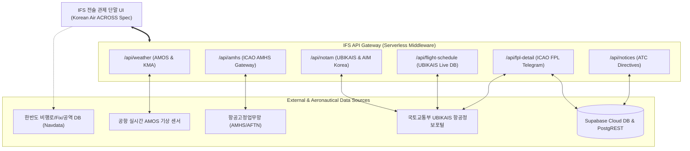

# IFS (Information Fusion System / 관제정보융합지원시스템) 기술 문서
**System Technical Specification & Architecture Whitepaper**

*문서 버전: v2.4.0 | 최종 개정일: 2026년 9월 22일 | 분류: 통합 항공관제(ATM) 시스템 기술 규격서*

---

## 1. 시스템 개요 및 개념 정의 (System Overview & Concept)

### 1.1 시스템 정의 (Definition)
**IFS(Information Fusion System, 관제정보융합지원시스템)**는 공항 관제탑(Tower), 접근관제소(Approach/APP), 항공교통관제센터(ACC), 항공작전통제센터(OCC) 등 항공교통업무(ATS) 현장에서 관제사 및 운항관리사가 신속하고 정확한 의사결정을 내릴 수 있도록 공항 및 주변 공역의 종합 상황을 실시간으로 직관적으로 파악할 수 있도록 다양한 항공 데이터(기상, 공항시설고시, 비행계획서, 운항스케줄, 공지사항 등)를 **단일 화면(Single Pane of Glass)에 융합(Fusion)하여 표출하는 차세대 전술 관제정보 지원 단말 시스템**입니다.

과거 관제 현장에서는 기상단말(AMOS 화면), 전문수신단말(AMHS), 항공고시보(NOTAM 뷰어), 운항정보스케줄(FIDS/UBIKAIS), 전자비행스트립(EFS)이 각각 분리된 독립 모니터로 운영되어 관제사의 인지 부하(Cognitive Load)가 가중되는 한계가 있었습니다. IFS는 이러한 이기종 시스템들의 데이터를 실시간 API 게이트웨이로 통합 수집·가공하여, 관제에 직결되는 정보만을 유기적으로 융합·표출합니다.



### 1.2 핵심 설계 철학 (Core Design Philosophy)
1. **인체공학적 저조도 다크 인터페이스 (Korean Air ACROSS Ergonomics)**:
   - 야간 및 암실 관제 환경에서 관제사의 시력 보호 및 눈부심 방지를 위해 매트 차콜 다크(`--bg: #111317`)와 스카이블루(`--primary: #57a8ff`)를 기조로 한 ACROSS 표준 규격 준수.
   - 전술 CRT 감성을 지원하는 그린 앰버 모드, 모노크롬, 딥 네이비, 데이라이트(라이트) 등 5가지 전술 테마 지원.
2. **단일 원천 데이터 융합 (Single Source of Truth Fusion)**:
   - 기상청 항공기상청(AMO), 국토교통부 항공정보포털(UBIKAIS/AIM Korea), 국제민간항공기구(ICAO FPL), 항행안전시설 정밀 DB(Navdata)를 단일 데이터 파이프라인으로 엮어 불일치 배제.
3. **무결성 및 즉시성 (Zero-Latency & High Reliability)**:
   - 2분 평균 자방위 풍향 / 10분 평균 진방위 풍향의 실시간 전환, 활주로별 정풍·배풍·측풍 벡터 자동 분해 계산.
   - 현재시각 기준선(Current-time Marker)을 통한 비행 스케줄 실시간 추적.
4. **DO-278A AL4 소프트웨어 보증 가이드라인 추적성**:
   - 보안 CORS 격리, 레이트 리미팅, 엄격한 입력 데이터 검증 및 예외 폴백(Graceful Degradation) 구조 설계.

---

## 2. 기술 스택 (Technology Stack Architecture)

IFS는 극한의 신뢰성과 렌더링 성능, 브라우저 이식성을 달성하기 위해 최적화된 모던 웹 기술과 마이크로서비스형 서버리스 아키텍처로 구축되었습니다.

| 계층 (Layer) | 분류 (Category) | 적용 기술 (Technology) | 세부 스펙 및 채택 사유 |
|:---|:---|:---|:---|
| **Frontend** | **UI Core** | **Vanilla HTML5 & ES2022+** | 무거운 프레임워크 오버헤드 없이 60fps 렌더링 및 저사양 관제 콘솔에서의 무지연성 보장 |
| | **Styling** | **CSS3 Native Variables & Grid** | 테마 런타임 동적 스위칭, 듀얼 스플릿 반응형 레이아웃, CRT Scanlines 주사선 셰이더 효과 |
| | **Typography** | **Pretendard, JetBrains Mono** | 관제 수치/호출부호 고가독성 모노스페이스 및 국영문 최적화 가변 글꼴 |
| | **Spatial / 3D** | **Mapbox GL JS v3.8.0** | 비행계획서(FPL) 비행로, 웨이포인트(Fix), 한반도 비행정보구역(Incheon FIR) 3D 시각화 |
| | **Icons** | **Inline SVG Vector** | 고해상도 DPI 환경에서도 왜곡 없는 벡터 그래픽 |
| **Backend** | **Runtime** | **Node.js (Serverless Functions)** | Vercel Serverless Architecture, 무중단 자동 스케일링 |
| | **Gateway API** | **Modular RESTful Endpoints** | `/api/weather`, `/api/amhs`, `/api/notam`, `/api/flight-schedule`, `/api/fpl-detail`, `/api/notices` |
| | **Crawler / Parser** | **Native Scrapers & Parsers** | UBIKAIS 실시간 인증 세션 풀, ICAO Q-Code 분해기, AMOS 테이블 실시간 파서 |
| **Database & Cache** | **Cloud DB** | **Supabase (PostgreSQL 15)** | PostgREST 연동, NOTAM 공간 좌표 쿼리, FPL 전문 영속화, 관제 지시문 실시간 동기화 |
| | **Memory Cache** | **Hot Instance In-Memory Cache** | TTL 5분 캐싱을 통한 외부 공공망 부하 방지 및 응답시간 <100ms 유지 |
| | **Client Storage**| **HTML5 LocalStorage** | 단말별 활주로 풍향 모드, 테마, 확대 배율(80%~150%), 언어 설정 보존 |
| **Protocol & Standards**| **Aviation Standard** | **ICAO Annex 3, 15 & Doc 4444** | ICAO 표준 FPL, METAR, SPECI, MET REPORT, TAF, NOTAM 포맷 규격 완전 호환 |

---

## 3. 핵심 모듈 및 기능 상세 (Core Functional Modules)

IFS는 화면 전체를 4개의 대형 전술 영역과 3개의 정밀 모달로 분할하여 구성합니다.

```
┌──────────────────────────────────────────────────────────────────────────────────┐
│ GNB Header: 브랜드 로고 | 서브시스템(AMHS, EFS) 펄스 | KST/UTC 시계 | 공항 셀렉터(15개소)  │
├──────┬───────────────────────────────────────────────────────────────────────────┤
│ LNB  │ [Module 1] AMOS 실시간 활주로 기상 센서 (자방위/진방위 토글, 정풍·측풍 벡터 분해)        │
│      ├─────────────────────────────────────┬─────────────────────────────────────┤
│ 대시 │ [Module 2-A] 기상 전문 (MET)        │ [Module 2-B] 공항 NOTAM 실시간 분류  │
│ 보드 │ - METAR / TAF / SPECI / SIGMET      │ - RWY/TWY, 항행등화, 공역, 📌고정    │
│ EFS  │ - 시맨틱 컬러 구문 강조 (Syntax)    │ - Q코드 파싱, 한글 해설, 간소화 모드 │
│ 레이 ├─────────────────────────────────────┴─────────────────────────────────────┤
│ 더   │ [Module 3] UBIKAIS 운항스케줄 (출발 DEPARTURES / 도착 ARRIVALS)                   │
│ 줌   │ - SEQ, FLT, TYP, REG, NAT, FPL, DES/ORG, SPT, RAM, ETD/ATD, ETA/ATA, STS, CHA     │
│ 설정 │ - 전 컬럼 클릭 정렬 + 현재시각 타임라인 실시간 추적선(Timeline Follow Bar)          │
│      ├─────────────────────────────────────┬─────────────────────────────────────┤
│      │ [Module 4-A] 대형 통합 원자시계     │ [Module 4-B] 관제 지시 및 공항 공지   │
│      │ - UTC / KST 1초 정밀 틱             │ - 다중 패널(패널+/-), 폰트크기 조절  │
└──────┴─────────────────────────────────────┴─────────────────────────────────────┘
```

---

### 모듈 1: 실시간 활주로 AMOS 기상 표출 (Runway Meteorological Section)
공항별 실측 기상 관측 장비(AMOS: Automated Meteorological Observing System)의 데이터를 실시간 표출합니다.
- **다중 활주로 분할 표출**: 대상 공항의 실제 물리 활주로 양방향(예: 여수공항 `RWY 17`, `RWY 35`, 인천공항 `15L/33R`, `15R/33L`, `16L/34R`, `16R/34L`) 센서 데이터를 독립 카드로 표출.
- **풍향 모드 스위칭**:
  - `2분 자방위 풍향 (2min Magnetic)`: 관제탑 이착륙 허가 시 사용하는 활주로 자침 방위 기준.
  - `10분 진방위 풍향 (10min True North)`: 기상대 정식 예보 및 METAR 기준의 진북 방위 기준.
- **풍속 단위 및 소수점 토글**: 관제 실무용 반올림 정수(`KT`) 또는 정밀 모니터링용 소수점(`0.0 KT`) 즉시 전환.
- **정풍/배풍/측풍 벡터 실시간 분해 알고리즘**:
  $$\theta = (\text{Wind Direction} - \text{Runway Heading}) \times \frac{\pi}{180}$$
  $$\text{Headwind} = \text{Wind Speed} \times \cos(\theta) \quad (\text{음수일 경우 Tailwind 배풍})$$
  $$\text{Crosswind} = \text{Wind Speed} \times |\sin(\theta)| \quad (\text{좌측/우측 풍향 방향 표기})$$
- **종합 관측 요소**: 기압치(QNH hPa 및 inHg 동시 산출), 기온(TMP), 이슬점(DP), 상대습도(RH), 시정(VIS), 활주로 가시거리(RVR: TD 접지대, MID 중간대, RO 말단대), 운저고도(Ceiling) 및 구름량(FEW/SCT/BKN/OVC).

---

### 모듈 2: 기상 전문(MET) & NOTAM 스플릿 (MET & NOTAM Split)

#### 2.1 기상 전문 (Raw MET Reports)
- **수신 전문군**: METAR(정시기상), MET REPORT(관제용 실시간 기상), SPECI(특별기상), TAF(공항예보), SIGMET(중요기상), AIRMET, WARNING(공항경보).
- **시맨틱 컬러 구문 강조 엔진 (Semantic Syntax Highlighting)**:
  - 바람: 청록색 (`35012KT`, `G25KT`)
  - 시정/RVR: 황록색 (`9999`, `R17/1200U`)
  - 기상현상: 붉은색 (`-RA`, `TS`, `FG`, `BR`)
  - 구름군: 주황색 (`FEW030`, `BKN050`, `CB`)
  - 기온/QNH: 보라색 및 파란색 (`22/15`, `Q1014`)

#### 2.2 공항 NOTAM 실시간 분류 및 관리 (NOTAM Management)
- **실시간 UBIKAIS / AIM Korea 연계**:
- **스마트 카테고리 필터링**:
  - `RWY_TWY`: 활주로 폐쇄, 유도로 포장 공사, 활주로 마킹 변경 (Q-Code: `QM...`)
  - `NAV_LGT`: ILS, VOR, DME 점검, PAPI, 진입등화 휴지 (Q-Code: `QN...`, `QL...`)
  - `AIRSPACE`: 사격 훈련 공역, 드론 비행 제한, 임시 비행금지구역 (Q-Code: `QR...`)
  - `PINNED`: 관제사가 중요 공지로 상단 고정한 NOTAM.
- **실시간 다차원 검색 및 간소화 모드**: NOTAM 번호, Q코드, 전문 본문 실시간 검색 및 불필요한 헤더를 숨기는 간소화 뷰.
- **NOTAM 정밀 분석 모달**: 항목 A(위치), B(발효시각), C(종료시각), D(주기), E(전문 국문 해설), F(하한고도), G(상한고도) 구조 분석 표 및 클립보드 원문 복사 제공.

---

### 모듈 3: 출발/도착 운항스케줄 (Flight Schedules)
국토교통부 UBIKAIS 항공정보 데이터베이스 스키마와 완벽히 호환되는 관제용 비행 스케줄 테이블입니다.

#### 3.1 규격 컬럼 정의
| 컬럼 ID | 명칭 | 설명 | 표기 규격 예시 |
|:---|:---|:---|:---|
| **SEQ** | 순번 | 일일 운항 순번 | `1`, `2`, `3` |
| **FLT** | 편명 | 호출부호 (Callsign) | `KAL1635`, `AAR8701` |
| **TYP** | 기종 | ICAO 항공기 기종 부호 | `A321`, `B738`, `HL8277` |
| **REG** | 등록기호 | 항공기 등록번호 (Tail No) | `HL8277`, `HL7788` |
| **NAT** | 운항성격 | Flight Nature | `PAX`(여객), `CGO`(화물), `TRN`(훈련), `MIL` |
| **FPL** | 비행계획서 | FPL 제출 및 유효 여부 | `Y`(승인/연계), `N`(미제출), `D`(지연) |
| **DES/ORG**| 목적/출발 | 비행장 ICAO 4자리 코드 | `RKSS`(김포), `RKPC`(제주) |
| **SPT** | 주기장 | 배정 주기장 및 스팟 번호 | `1`, `2`, `GATE 3` |
| **RAM** | 램프시각 | 램프 아웃 / 인 예상 시각 | `08:35`, `14:20` |
| **ETD/ATD**| 출발시각 | 계획 출발 / 실제 출발 | `08:40` (ATD 발생 시 녹색 하이라이트) |
| **ETA/ATA**| 도착시각 | 계획 도착 / 실제 도착 | `09:24` (ATA 발생 시 녹색 하이라이트) |
| **STS** | 운항상태 | 실시간 항공기 진행 상태 | `SCH`, `DEP`, `ARR`, `AIR`, `DLY`, `CNL` |
| **CHA** | 변경구분 | 계획 변경 표시 | `REV`, `MOD`, `-` |

#### 3.2 현재시각 타임라인 자동 추적선 (Timeline Follow Mode)
스케줄 테이블 내에 현재 시각(KST/UTC)의 가상 위치를 계산하여 주황색 네온 라인(`timeline-now-row`)을 동적으로 삽입하고, 항공기 운항 진행 상황에 맞춰 테이블 스크롤이 현재 시점의 비행편을 자동 추적합니다.

---

### 모듈 4: 전자비행스트립 카드 및 Mapbox 3D 비행로 뷰어 (Flight Detail Modal)
스케줄 내 임의의 항공편을 클릭하면 팝업되는 항공기 전술 종합 분석 모달입니다.
1. **전자비행스트립 카드 (EFS Card)**:
   - 운항 제원, 등록기호, IFR/VFR 비행방식, 주기장 정보 통합 요약.
2. **비행계획서 원문 전문 (ICAO FPL Telegram)**:
   - `(FPL-KAL1635-IS -A321/M-SDE3FGHIRWXY/LB1 -RKJY0840 -N0420F240 G597 SEL -RKSS0044 -PBN/A1B1DOF/260922...)` 원문 ICAO 텔레그램을 비동기 조회하여 표출.
3. **고도 프로파일 차트 (Vertical Route Profile)**:
   - 이륙, 순항(FL240), 강하, 접근 경로의 수직 고도 다이어그램 렌더링.
4. **Mapbox GL JS 3D 비행로 시각화 (Route Visualizer)**:
   - 전국의 웨이포인트(`korean_navdata_fixes.json`)와 항공로(`korean_navdata_airways.json`) 네트워크를 로드하여 출발지부터 목적지까지의 3D 비행 항적 선을 실시간 렌더링.
5. **최소화 닥바 (Flight Dock Bar)**:
   - 여러 비행편을 동시에 분석할 수 있도록 모달을 우측 하단 탭(`🗕`)으로 축소하여 상시 모니터링 가능.

---

## 4. 백엔드 API 게이트웨이 사양 (Backend API Gateway Specification)

IFS 단말과 연동되는 백엔드 서버리스 마이크로서비스 인터페이스 목록입니다.

```
+-----------------------------------------------------------------------------------+
| Endpoint               | Method | Query Parameters         | 주요 반환 데이터           |
+------------------------+--------+--------------------------+----------------------+
| /api/weather           | GET    | type=amos, icao=RKJY     | 활주로별 풍향풍속, 기온, QNH, RVR |
| /api/amhs              | GET    | type=RAW_ALL, icao=RKJY  | METAR, SPECI, TAF 원문 텔레그램 |
| /api/notam             | GET    | location=RKJY, period=cur| Q코드 파싱 NOTAM JSON 리스트 |
| /api/flight-schedule   | GET    | airport=RKJY             | UBIKAIS 실시간 출발/도착 배열  |
| /api/fpl-detail        | GET    | amsRecPk=..., flt=KAL1635| ICAO FPL 원문 및 JSON 제원  |
| /api/notices           | GET/POST| icao=RKJY               | 공항별 관제 지시 및 공지사항  |
| /api/data-status       | GET    | (none)                   | 하위 서브시스템 연결 상태 및 핑 |
+-----------------------------------------------------------------------------------+
```

---

## 5. UI/UX 및 인체공학적 설계 사양 (User Experience & Ergonomics)

### 5.1 5대 전술 테마 규격
1. **Korean Air ACROSS (기본 테마)**: 현대적인 매트 다크 차콜 바탕(`--bg: #111317`), 시인성 높은 스카이블루 액센트(`--primary: #57a8ff`), 슬레이트 테두리.
2. **Tactical CRT Green**: 공군 및 군용 레이더 감성의 블랙 바탕(`--bg: #111111`)과 형광 그린 인광체 색상(`--primary: #00ff00`).
3. **Dark Mono White**: 절제된 고대비 흑백 단말 감성(`--bg: #09090b`, `--primary: #ffffff`).
4. **Deep Navy Blue**: 해군 및 해상 항공 레이더 콘솔용 딥 네이비 감성(`--bg: #0b1329`, `--primary: #38bdf8`).
5. **Daylight Radar (주간 모드)**: 주간 자연광 직사 환경을 위한 고휘도 오프화이트 모드(`--bg: #ececf1`, `--primary: #007bff`).

### 5.2 CRT 스캔라인 아날로그 이펙트
- CSS 주사선 셰이더(`.scanlines`)를 통해 브라운관 모니터의 미세한 수평 주사선 및 비네팅을 시뮬레이션하여 관제사 눈의 피로도를 경감.

### 5.3 줌 스케일링 & 다국어 i18n
- **UI Zoom Engine**: `80%`부터 `150%`까지 `0.1` 단위로 즉각적인 화면 배율 확대/축소 지원 (원터치 `100%` 초기화).
- **3대 언어 모드**: `한/영 혼재 (bilingual)`(기본 관제 표준), `한글 전용 (ko)`, `English (en)`.

---

## 6. 결론 및 향후 로드맵 (Conclusion & Future Roadmap)

**IFS(관제정보융합지원시스템)**는 단편적인 관제 화면을 탈피하여 **기상, 비행계획, 운항 스케줄, 항공고시보, 3D 항로**를 관제사의 인체공학적 동선에 맞추어 완벽히 융합해 낸 차세대 스마트 항공관제 솔루션입니다.

### 향후 로드맵
1. **AI 기반 항공기 지연 및 착륙 순서 예측(AMAN/DMAN 융합)**: 기상 악화 시 활주로 용량 감소에 따른 지연 시간 자동 산출.
2. **CPDLC (데이터링크 관제통신) 게이트웨이 연계**: 조종사-관제사 간 텍스트 기반 관제인가 연계.
3. **ADS-B 및 ASTERIX 감시 레이더와의 양방향 스트리밍 결합**: 지상 활주로부터 고공 순항까지 일관된 항공기 추적 융합.
